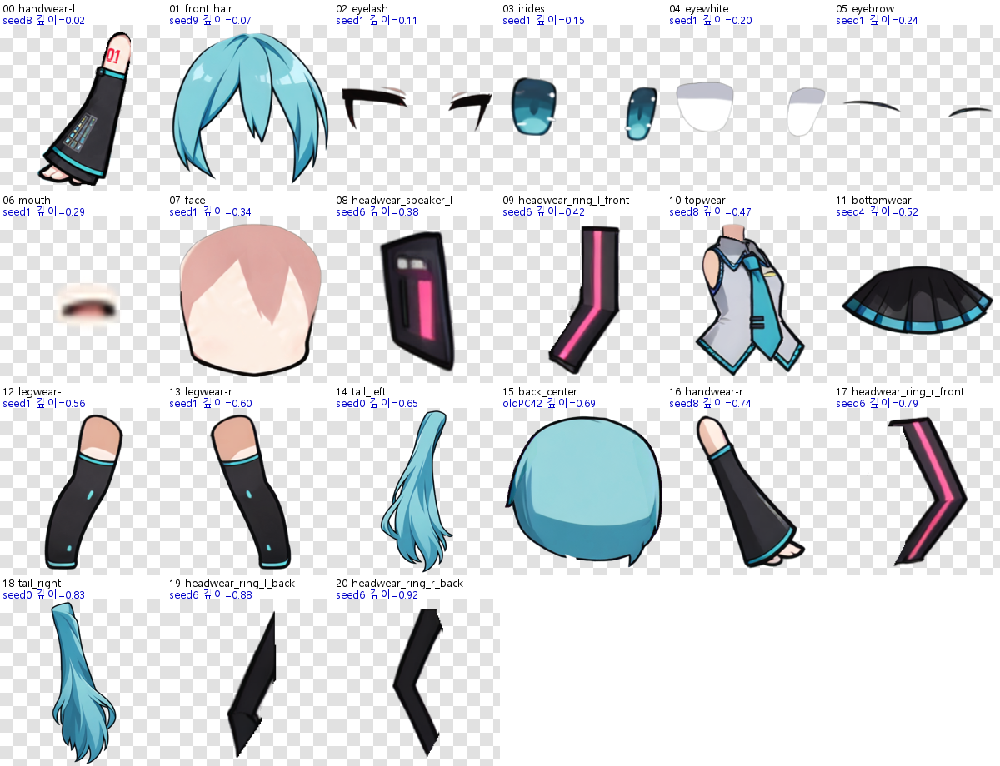

# sd-character-i2l

애니메이션 캐릭터 그림 **한 장**을 리깅·애니메이션용 **레이어 PSD**로 나누는 로컬 작업 기록과 도구 모음이에요.
목표는 **리깅할 수 있게 레이어를 나누는 것까지**예요. 리깅 자체(뼈 구조, 움직임)는 범위 밖이에요. 예시의 뼈(`rig.json`의 `bones`)와 자세는 나눈 조각이 잘 움직이는지 확인하려고 임시로 만든 테스트용이에요.
레이어 분리에는 [See-through](https://github.com/mitmul/see-through)를 쓰고, 그 위에 seed 고르기, 레이어 섞기, 가려진 부분 생성, 검토 이미지 같은 도구를 더했어요.

자동 파이프라인이 아니라 **사람이 단계마다 확인 이미지를 보고 고르는 반자동 흐름**이에요. 그 흐름과 막혔던 곳, 해결한 방법을 같이 정리했어요.

| 원본 | v1 결과 합성 (21레이어) |
|---|---|
|  |  |



## 결과물 두 가지: v1과 v2
같은 그림을 두 단계로 나눠요. v2는 v1을 더 잘게 자른 것이라, v2의 기본 레이어를 쌓으면 v1과 같은 그림이 돼요.

| | **v1: 레이어 PSD** ([final_v1](examples/miku/final_v1/README.md)) | **v2: 리깅용으로 나눈 레이어** ([final_v2](examples/miku/final_v2/README.md)) |
|---|---|---|
| 만드는 단계 | 작업 흐름 1~7 (생성·고르기·합치기·가려진 곳 채우기·손질) | 작업 흐름 8~9 (관절·손·트윈테일·표정 나누기, 나눔 확인) |
| 레이어 수 | 21 | 45 + 바꿔 끼우는 파츠 |
| 나누는 단위 | 부위 덩어리: 팔 한 장, 다리 한 장, 트윈테일 한 장, 눈 좌우 한 장 | 움직이는 단위: 소매/맨팔 하박·상박/손, 허벅지/종아리, 트윈테일 뿌리·중간·끝, 눈 좌/우 |
| 바꿔 끼우기 | 없음 | 손 모양(l 6종·r 7종), 표정 11종, 안 자른 트윈테일 |
| 함께 있는 정보 | `spec.json`(레이어마다 고른 seed·처리) | `rig.json`(그리는 순서, 슬롯, 확인용 테스트 뼈) |
| 이럴 때 써요 | 리깅 없이 부위별 레이어만 필요할 때: 배경 지우기, 색 바꾸기, 가벼운 흔들기, 일러스트 편집 | 리깅 도구(Spine, Live2D 등)에서 팔다리를 굽히고 손·표정을 바꾸려 할 때 |

**왜 둘 다 두나요?**
- **v1이 필요한 이유:**
  - 리깅이 필요 없으면 v1이 최종본이에요. 잘게 나뉜 v2보다 다루기 쉬워요.
  - v2를 만드는 재료이고, v2가 원래 그림과 같은지 비교하는 기준이에요(`final_v2/v1_diff.png`).
  - 나누는 방식을 바꿔 v2를 다시 만들 때 여기서 시작해요.
- **v2가 필요한 이유:** v1만으로는 움직일 수 없는 것들이 있어요.
  - 팔꿈치·무릎에서 굽히기
  - 손 모양·표정 바꾸기
  - 트윈테일 휘기
  - 한쪽 눈만 감기

v2를 만들면서 새로 그린 곳은 맨팔·손과 바꿔 끼우는 파츠뿐이에요. 나머지는 v1 레이어를 자르기만 했어요.

---

## 무엇을 할 수 있나
- 그림 한 장 → 최대 24개 고정 태그(앞머리, 뒷머리, 얼굴, 눈, 옷 …) 레이어 + 깊이 (See-through, NF4 양자화로 **8GB GPU**에서 실행)
- 같은 그림을 여러 seed로 생성해 **레이어마다 가장 좋은 seed를 골라 섞기** (`tools/mix_layers.py`)
- 머리 부위가 잘리지 않게 머리 자르기 상자를 자동으로 넓히기 (`tools/head_grow.py`)
- 글로 부위를 지정해 레이어를 더 나누기: Grounding DINO + SAM2 + LaMa (`tools/text_layers.py`)
- 앞 레이어에 가려진 부분을 SDXL 인페인팅으로 그리기 (`tools/amodal_complete.py`)
- 리깅용 나누기: 관절(무릎·팔꿈치) 자르기 + 관절 외곽선, 트윈테일 체인, 소매 천만 남기기, 표정·손 모양 바꿔 끼우기 파츠, 뼈·슬롯 정보(`rig.json`) (`tools/split_joint.py`, `split_chain.py`, `sleeve_cloth.py`, `face_parts.py`)
- 단계별 검토 이미지, seed·버전 비교 시트, 레이어 잔선 측정

## 문서
| 문서 | 내용 |
|---|---|
| [docs/INSTALL.md](docs/INSTALL.md) | 설치 (conda 환경, torch, See-through, 모델 다운로드) |
| [docs/ENVIRONMENT.md](docs/ENVIRONMENT.md) | 테스트한 GPU·드라이버·버전, 모델 목록과 용량, 메모리 |
| [docs/WORKFLOW.md](docs/WORKFLOW.md) | 그림 한 장 → PSD → 리깅용 조각까지의 작업 흐름 (예시 이미지 포함) |
| [docs/RIGGING_TOOLS.md](docs/RIGGING_TOOLS.md) | 리깅 도구로 넘기기: Stretchy Studio·Layer2D 검토, Stretchy용 PSD, 실제 시험(자동 인식·굽히기) 결과와 쓰는 법 |
| [docs/TOOLS.md](docs/TOOLS.md) | 도구 스크립트·함수·옵션 설명 |
| [docs/TROUBLESHOOTING.md](docs/TROUBLESHOOTING.md) | 문제 → 원인 → 해결 과정 |
| [docs/HISTORY.md](docs/HISTORY.md) | 작업 기록 (시간순) |

## 빠른 시작
설치는 [docs/INSTALL.md](docs/INSTALL.md)를 따라 하세요. 설치가 끝나면 폴더가 이렇게 돼요.
```
sd-character-i2l/
├─ env/          conda 환경 (설치 때 만듦)
├─ hf_cache/     모델 (설치 때 받음, 약 15GB)
├─ see-through/  See-through 코드 (설치 때 clone, 커밋 e4cb250)
└─ tools/
```
```powershell
# 1) 같은 그림을 seed 0~9로 생성
#    RTX 5060 Ti 16GB 기준 seed 하나에 약 5~10분 (머리 단계를 다시 돌린 횟수에 따라 312~573초), GPU 메모리 약 8GB
Set-ExecutionPolicy -Scope Process -ExecutionPolicy Bypass   # 지금 창에서만 .ps1 실행 허용
foreach ($s in 0..9) {
  & .\tools\run_seethrough.ps1 -Src C:\work\my_char.png -OutDir C:\work\out\seed$s `
    -Extra @('--no_group_offload','--tblr_split','--seed',"$s") -HeadGrow 3
}
# 2) seed 비교 시트
.\env\Scripts\python.exe tools\compare_seeds.py --run s0=C:\work\out\seed0 --run s1=C:\work\out\seed1 --out C:\work\out\compare.png
# 3) 레이어마다 seed를 골라 spec.json을 쓰고 합치기
.\env\Scripts\python.exe tools\mix_layers.py --spec C:\work\spec.json --out C:\work\out\mix
```
spec 예시는 [examples/miku/final_v1/spec.json](examples/miku/final_v1/spec.json), 옵션은 [docs/TOOLS.md](docs/TOOLS.md)에 있어요.

## 예시 (`examples/miku/`)
| 폴더 | 내용 |
|---|---|
| `input/` | 원본 그림 (1312×1199) |
| `final_v1/` | v1: 레이어 PSD(`miku_v1.psd`, 21레이어), 레이어 PNG, 합성·시트·가려짐 확인 이미지, `spec.json` |
| `final_v2/` | 리깅용으로 나눈 레이어 45장, `rig.json`(그리는 순서·바꿔 끼우는 슬롯, 확인용 테스트 뼈), 표정·손·트윈테일 바꿔 끼우기, `miku_v2.psd`, 확인 시트 |
| `rig/` | 리깅용 나누기 과정: 다리(legs), 팔·소매·손(arms), 트윈테일(tails), 표정 파츠(face), 사람이 그은 선, 확인 스크립트 |
| `headwear/` | 헤드셋 고리를 앞/뒤로 나눈 과정 (생성 결과, 사람이 빨간 선으로 표시한 그림, 6조각) |
| `manual/` | 사람이 직접 다듬은 레이어, 지울 곳 표시와 마스크 |
| `back_center/` | 가려진 뒤통수를 분리·생성한 과정 (text_layers, amodal 후보) |

seed 10개와 중간 합치기 결과는 용량이 커서 넣지 않았어요. 대표 이미지는 [docs/WORKFLOW.md](docs/WORKFLOW.md)에 있어요.
`spec.json` 안의 `seethrough_test/...` 경로는 그 중간 결과를 가리켜서, 예시 spec은 그대로 다시 돌릴 수 없고 형식 참고용이에요.

## 모델과 라이선스
모델 가중치는 저장소에 없어요. 처음 실행할 때 Hugging Face에서 받아요. 쓰기 전에 각 모델 카드의 라이선스를 확인하세요.

| 모델 | 쓰는 곳 | 라이선스 |
|---|---|---|
| [24yearsold/seethroughv0.0.2_layerdiff3d_nf4](https://huggingface.co/24yearsold/seethroughv0.0.2_layerdiff3d_nf4) | 레이어 생성 | openrail++ |
| [24yearsold/seethroughv0.0.1_marigold_nf4](https://huggingface.co/24yearsold/seethroughv0.0.1_marigold_nf4) | 깊이 | openrail++ |
| [frankjoshua/juggernautXL_version6Rundiffusion](https://huggingface.co/frankjoshua/juggernautXL_version6Rundiffusion) | See-through가 설정 파일만 참조 (가중치는 안 받음) | 모델 카드 참고 |
| [diffusers/stable-diffusion-xl-1.0-inpainting-0.1](https://huggingface.co/diffusers/stable-diffusion-xl-1.0-inpainting-0.1) | amodal_complete, mask_inpaint (`--model`로 바꿀 수 있음) | openrail++ |
| [IDEA-Research/grounding-dino-base](https://huggingface.co/IDEA-Research/grounding-dino-base) | text_layers (글 → 상자) | Apache-2.0 |
| [facebook/sam2.1-hiera-large](https://huggingface.co/facebook/sam2.1-hiera-large) | text_layers (상자 → 마스크) | Apache-2.0 |
| [dreMaz/AnimeMangaInpainting](https://huggingface.co/dreMaz/AnimeMangaInpainting) (LaMa) | text_layers (틈 메우기) | 모델 카드 참고 |

**SDXL 인페인팅 모델을 고른 근거:** 가려진 부분 그리기(key 모드)를 애니메이션 SDXL 3종(Animagine XL 4.0, NoobAI-XL 1.1, Illustrious XL v0.1)과 같은 설정·seed 5개로 비교했어요. 색 오차 중앙값이 가장 낮았고(기본 8.1 / 10.1 / 8.9 / 33.2), 가려진 모양도 가장 많이 이어 그렸어요. 애니메이션 모델은 인페인팅 전용이 아니라서 평균 0.4~0.6배만 그렸어요. 자세한 결과: [TROUBLESHOOTING](docs/TROUBLESHOOTING.md#4-다시-그리기-sdxl)

## 라이선스
- 이 저장소의 코드와 문서: [Apache License 2.0](LICENSE)
- See-through 코드를 고쳐 쓴 파일이 있어요 (`tools/head_grow.py`, `tools/run_patched.py`). 출처는 [NOTICE](NOTICE)에 적었어요.
- 예시 그림의 캐릭터 하츠네 미쿠는 Crypton Future Media의 캐릭터예요. 예시 이미지는 비영리 작업 기록용이에요.
