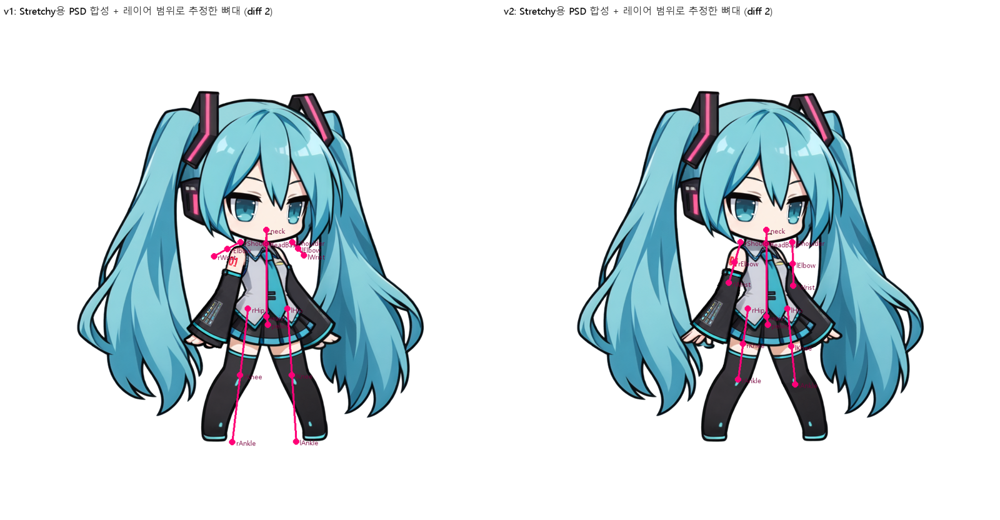
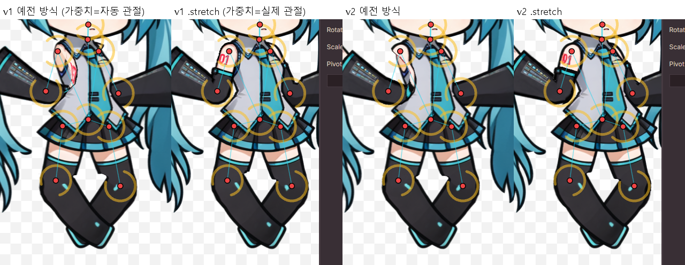
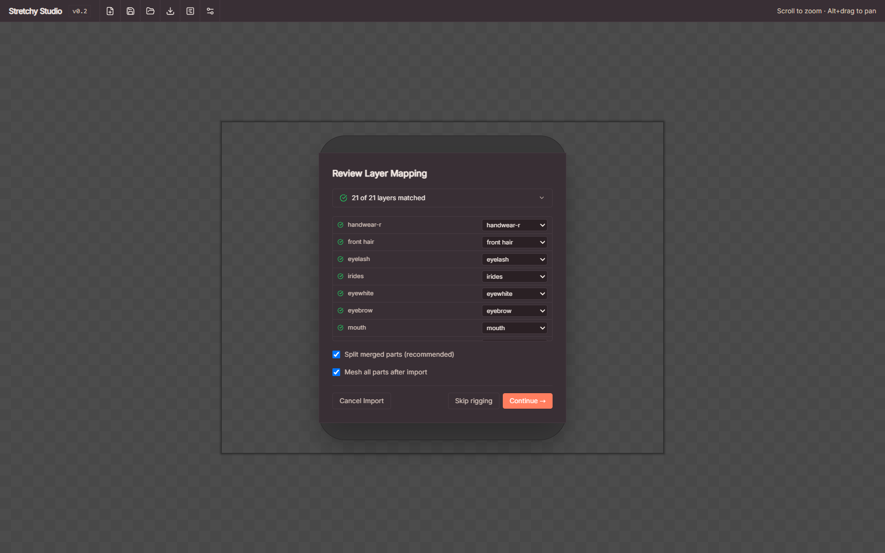
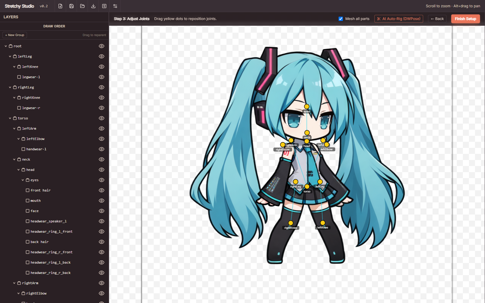
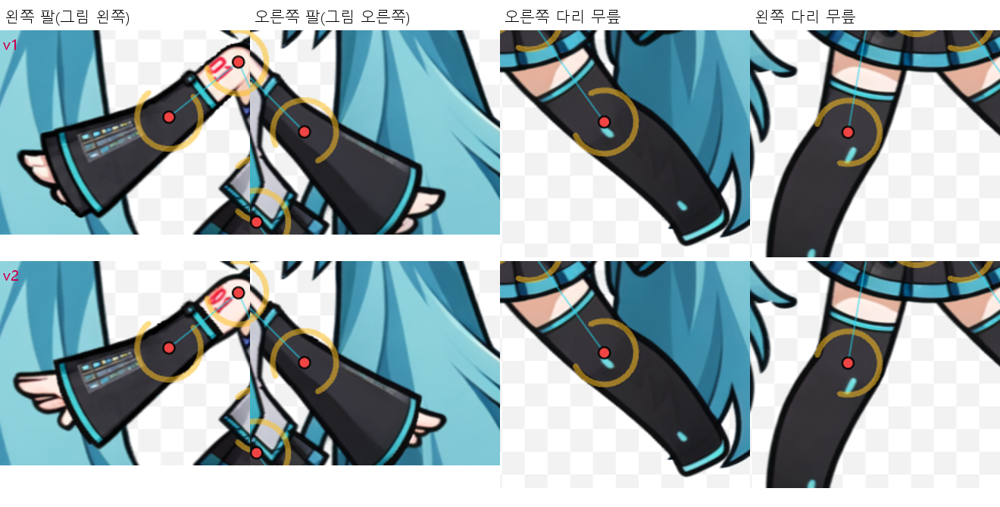

# 리깅 도구로 넘기기

이 프로젝트는 **리깅할 수 있게 레이어를 나누는 것까지**예요. 실제 리깅(뼈, 메시, 움직임)은 리깅 도구에서 해요.
여기에는 나눈 레이어를 어떤 도구에 어떻게 넘기는지와, 직접 시험해 본 결과를 적었어요 (2026-11-26).

## 검토한 오픈소스
| | [Stretchy Studio](https://github.com/MangoLion/stretchystudio) | [Layer2D](https://github.com/JagTheHero/layer2d) |
|---|---|---|
| 무엇인지 | 그림 레이어를 메시 변형 캐릭터로 만드는 2D 애니메이션 편집기(브라우저) | 자체 아바타 형식(.l2d) + 플레이어 + 리깅 스튜디오 + AI 에이전트용 리깅 도구 |
| 라이선스·상태 | MIT, 별 536, 마지막 커밋 2026-04 | MIT, 별 5, 2026-11-23에 만들어져 하루에도 여러 번 바뀌는 중 |
| See-through와의 관계 | **See-through 결과를 받도록 만듦**: 레이어 이름을 See-through 태그로 알아봄 | PSD는 받지만 이름을 자체 규칙(bangs, side hair, arm …)으로 분류 |
| 중심 기능 | 팔다리를 메시로 굽힘, 자동 뼈대, 타임라인 애니메이션 | 정면 VTuber: 고개 좌우 돌림 단계, 웹캠 머리 추적, 립싱크 |
| 우리와 맞는 정도 | **잘 맞음** (아래 시험) | 우리 캐릭터는 옆모습 하나만 쓰기로 해서(반대쪽은 좌우 반전) 중심 기능이 맞지 않음. 너무 새로워서 형식도 바뀔 수 있음 |

## Stretchy Studio가 만드는 것
레이어 PSD를 받아 움직이는 캐릭터를 만들고, 다른 프로그램이 쓰는 형식으로 내보내요 (소스 `src/io/`, `docs/` 확인).

| 내보내기 | 내용 | 쓰는 곳 |
|---|---|---|
| 이미지 프레임 | 만든 동작을 PNG·WEBP·JPG 연속 이미지(또는 한 장)로, ZIP | 게임 스프라이트, GIF·영상 재료 |
| Live2D | 실행용 `.moc3` + `model3.json` + 텍스처 + `.motion3.json`, 또는 편집용 `.cmo3`(Cubism Editor 5) | Live2D 앱(VTube Studio 등), Ren'Py, 게임 엔진. 메시 굽힘(뼈 가중치를 모양 단계로 구워 넣음)과 머리카락 흔들림 물리도 같이 |
| Spine 4.0 JSON | 뼈 + 조각 이미지 + 동작(이동·회전·투명도) | Spine 런타임을 쓰는 게임 엔진 |

- **Live2D:** 메시 굽힘이 같이 나가요. 팔다리가 한 장인 v1으로도 충분해요.
- **Spine:** 문서상 조각을 이미지 한 장(region attachment)으로 내보내요.
  - 메시 굽힘은 빠지고 조각 회전만 남아요.
  - 그래서 **관절에서 자른 v2가 필요한 곳**이에요.

## Stretchy용 PSD
원래 PSD(`miku_v1.psd`, `miku_v2.psd`)를 그대로 넣으면 두 가지가 문제예요. 그래서 따로 만들어요.
- 만드는 스크립트: [`examples/miku/rig/export_stretchy.py`](../examples/miku/rig/export_stretchy.py)
- 결과 파일:
  - [`final_v1/miku_v1_stretchy.psd`](../examples/miku/final_v1/miku_v1_stretchy.psd)
  - [`final_v2/miku_v2_stretchy.psd`](../examples/miku/final_v2/miku_v2_stretchy.psd)
  - 각 PSD와 같은 이름의 `.json`(이름 대응표)

1. **레이어가 모두 1024×1024 전체 크기:** Stretchy는 레이어 범위로 뼈 위치를 추정해요. 이대로면 모든 레이어가 캔버스 전체로 보여요.
   → 레이어를 그림 범위로 잘라 저장해요(위치는 그대로).
2. **Stretchy 안의 좌우 기준이 서로 다름:**
   - 레이어를 좌우로 나누는 기능(`splitLR.js`)은 그림 왼쪽을 `-l`이라고 불러요(우리와 같은 기준).
   - 뼈대(DWPose의 COCO 관절, 범위 추정 모두)는 `leftArm`을 캐릭터 본인의 왼쪽, 즉 정면 그림에서 그림 오른쪽에 둬요.
   - 우리 이름 그대로면 팔다리가 반대쪽 어깨·엉덩이에 붙어요(시뮬레이션에서 다리 X자).
   → **캐릭터 기준으로 바꿔요**(우리 `_l` = 그림 왼쪽 → `-r`).
3. **이름:**
   - See-through 태그로 바꿔요: `front_hair` → `front hair`, `back_center` → `back hair`, 눈은 `eyelash-l` 등.
   - Stretchy의 `matchTag`는 태그 목록을 앞에서부터 검사해요. 그래서 `handwear-l_forearm`은 `handwear`(양팔)로 가고, 왼팔 뼈에는 이름이 **정확히** `handwear-l`인 레이어만 붙어요.
   - 그래서 v2의 팔·다리 조각은 모두 같은 이름(`handwear-l/r`, `legwear-l/r`)이에요.
4. **바꿔 끼우는 파츠는 넣지 않아요.** Stretchy는 숨긴 레이어와 그룹 안 레이어까지 모두 가져와서 리깅해 버려요.

*Stretchy의 범위 추정을 똑같이 따라 그린 것 (캐릭터 기준으로 바꾼 뒤). 다리는 맞지만 손목이 팔 레이어 위쪽에 잡혀요*

## 시험 결과 (웹 편집기, 2026-11-26)
https://editor.stretchy.studio 를 브라우저 자동화(Playwright + Edge)로 열어 PSD를 넣고 마법사를 진행했어요 (스크립트 [`examples/miku/rig/stretchy_test/`](../examples/miku/rig/stretchy_test/)).

| 단계 | 결과 |
|---|---|
| 레이어 대응 | v1 **21/21**, v2 **45/45** 자동 인식 |
| 그리는 순서 | 원래 순서 그대로, 그림도 원본과 같음 |
| 자동 뼈대: 레이어 범위 | 팔다리가 올바른 쪽에 붙음. 팔꿈치가 어깨 바로 옆, 무릎이 다리 중간쯤이라 손으로 옮겨야 함 |
| 자동 뼈대: AI 자세 인식(DWPose) | **실패**: 엉덩이·팔꿈치가 오른쪽 아래 머리카락에, 무릎이 트윈테일 안에. 머리가 큰 SD 체형을 못 잡는 듯 |
| 굽히기 (처음 시험) | 관절 기준점을 나중에 옮기고 속성 창에 회전값을 숫자로 넣음 → 팔꿈치·무릎은 **실제로 굽지 않았어요**(처음엔 굽었다고 잘못 봄, 보인 건 어깨·엉덩이 회전) |
| 굽히기 (`.stretch`, 2026-11-27) | 관절 먼저 → 팔다리 Remesh → 캔버스에서 관절 호를 마우스로 끌기 → **실제 팔꿈치·무릎에서 꺾임**. 관절을 나중에 옮긴 예전 방식은 위팔이 찢어지듯 늘어남 |

*그림 왼쪽 팔꿈치 90°, 무릎 ±60°를 호를 끌어 굽힘. 왼쪽 두 칸 v1, 오른쪽 두 칸 v2 (각각 예전 방식 / .stretch)*

## Stretchy에서 쓰는 법 (miku 기준)
**가장 쉬운 방법:** 관절을 미리 넣어 둔 [`final_v1/miku_v1.stretch`](../examples/miku/final_v1/miku_v1.stretch)(또는 `final_v2/miku_v2.stretch`)를 편집기에 끌어다 놓아요. 아래 1~3단계가 이미 되어 있어요 (만든 스크립트 `stretchy_test/st5.py`).

PSD에서 직접 시작할 때:
1. 편집기에 `miku_v1_stretchy.psd`(또는 v2)를 끌어다 놓아요 → 레이어 대응이 모두 초록인지 봐요.
2. Continue → 그리는 순서 확인 → **Adjust Joints에서 DWPose를 쓰지 말고** Finish Setup을 눌러요(범위 추정 뼈대).
3. 관절 그룹을 골라 오른쪽 속성 창의 Pivot에 `rig.json` 테스트 뼈 위치를 넣어요(캔버스 좌표가 같아요).
   - Stretchy는 **캐릭터 기준**이에요: `leftArm`·`leftElbow` = 우리 `upperarm_r`·`forearm_r`.

     | Stretchy | rig.json 뼈 | 기준점 |
     |---|---|---|
     | `rightArm` | `upperarm_l` | (488, 480) |
     | `rightElbow` | `forearm_l` | (466, 555) |
     | `leftArm` | `upperarm_r` | (565, 480) |
     | `leftElbow` | `forearm_r` | (602, 559) |
     | `rightLeg` | `thigh_l` | (497, 620) |
     | `rightKnee` | `shin_l` | (485, 722) |
     | `leftLeg` | `thigh_r` | (584, 621) |
     | `leftKnee` | `shin_r` | (605, 732) |
   - **그다음 팔다리 레이어(`handwear-*`, `legwear-*`)마다 속성 창의 Remesh를 눌러요.**
     - Stretchy는 메시를 만들 때의 관절 위치로 팔꿈치·무릎 가중치를 계산해요(관절 앞뒤 40px에서 서서히).
     - 마법사가 끝날 때 이미 자동 관절 기준으로 메시가 만들어져 있어서, Remesh를 안 하면 위팔이 찢어지듯 늘어나요.
4. **굽히기는 캔버스에서 관절의 노란 호를 마우스로 끌어요.** 속성 창 Rotation에 숫자를 넣으면 팔꿈치·무릎 메시는 휘지 않아요(가중치 계산이 호를 끌 때만 돌아요, `SkeletonOverlay.jsx`).
5. Animation 모드에서 동작을 만들고 Export로 내보내요.

## 알게 된 것
- **Stretchy는 메시를 변형해서 굽혀요.** 팔다리가 한 장인 v1도 잘 굽고, Stretchy·Live2D에서는 v2의 관절 조각이 꼭 필요하지 않아요.
- **v2가 필요한 곳:**
  - Spine처럼 조각을 회전만 시키는 도구
  - 눈 좌우 분리(한쪽 눈 감기)
  - 손·표정 바꿔 끼우기. 단, Stretchy에는 자동으로 들어가지 않아요.
- **SD 체형은 AI 자세 인식에 기대지 말 것:** 범위 추정으로 뼈대를 만들고 관절 위치만 `rig.json` 값으로 고치는 게 맞아요.
- **순서: 관절 → Remesh → 호 끌기.** 관절을 나중에 옮기거나 숫자로 회전하면 제대로 안 굽어요.
- **메시 변형 설정:** 속성 창 Mesh → Settings(바꾼 뒤 Remesh)에서 파츠마다 또는 전체로 정해요.
  - Grid Spacing: 안쪽 점 간격. 기본은 면적의 제곱근 × 0.08(6~80)이고, 작을수록 촘촘해서 부드럽게 휘어요.
  - Edge Points: 윤곽선 점 수. 기본은 면적의 제곱근 × 0.4(12~300)예요.
  - Edge Padding(8), Alpha Threshold(5), Smooth Passes(0)
  - Edit Mesh에서는 Deform 브러시(크기 5~300, 단단함 0~100)로 점을 직접 밀거나, 점을 더하고 뺄 수 있어요.
  - 모양 키는 휘어진 모양을 0~1로 섞어요.
  - 팔꿈치·무릎이 휘는 폭은 코드에 40px로 고정이고 화면 설정은 없어요. `.stretch` 안 `project.json`의 점별 `boneWeights`를 고치면 바꿀 수 있어요.

## 다음에 해 볼 수 있는 것 (아직 안 함)
- **Live2D·Spine으로 내보내기 시험:** v1과 v2가 각각 어떻게 나오는지.
- **짧은 동작(숨쉬기·손 흔들기)을 프레임으로 내보내기:** 움직일 때 이음매 확인.
