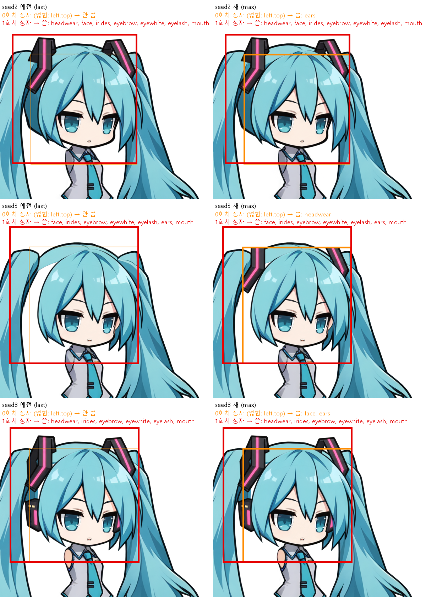
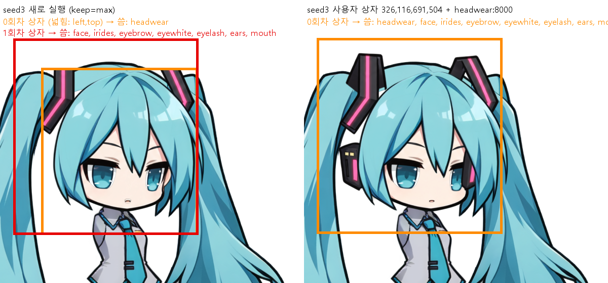
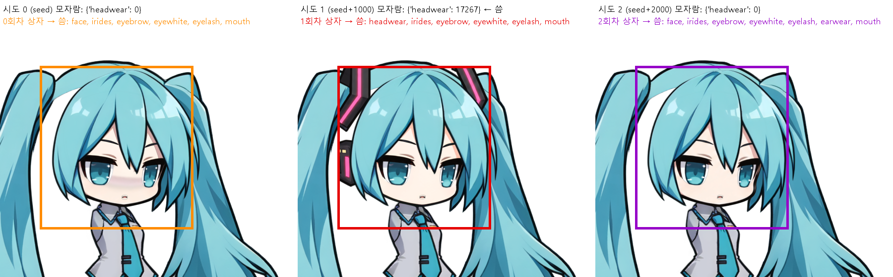
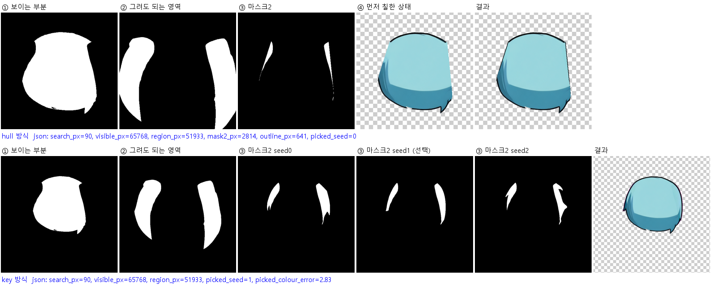
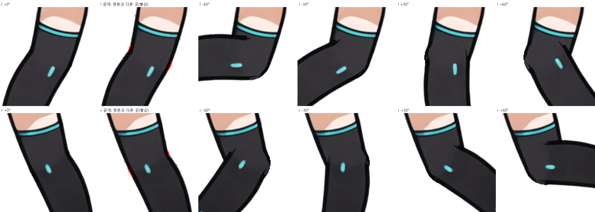
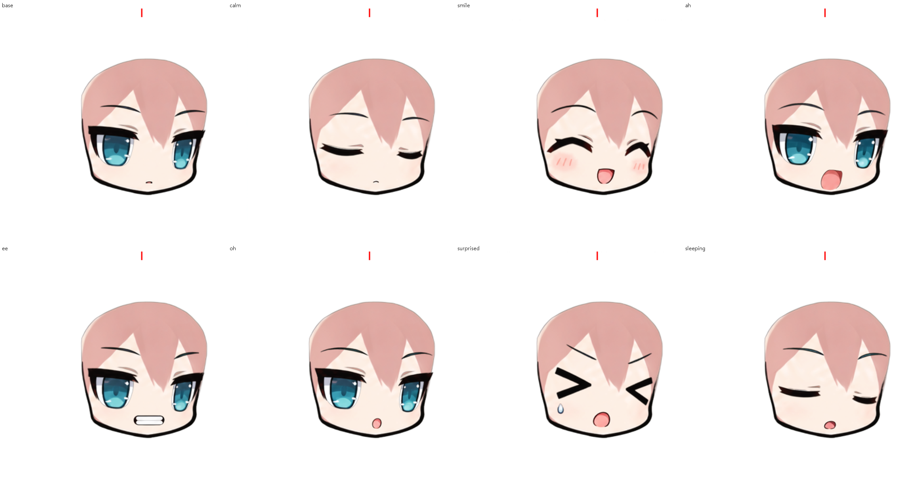
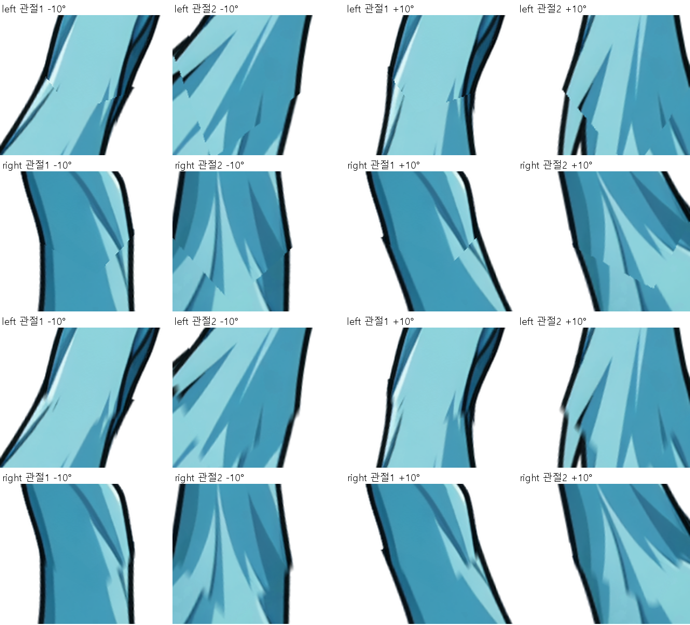

# 도구 설명

모든 도구는 `tools/`에 있고, `tools`의 상위 폴더(또는 환경 변수 `I2L_ROOT`)를 기준으로 `env`, `hf_cache`, `see-through`를 찾아요.
`$PY`는 `env\Scripts\python.exe`(venv) 또는 `env\python.exe`(conda)예요.

| 단계 | 도구 | 하는 일 | GPU |
|---|---|---|---|
| 생성 | [run_seethrough.ps1](#run_seethroughps1) | See-through 한 장 실행 + 시간·메모리 기록 | ✔ |
| | [run_patched.py](#run_patchedpy) | See-through 스크립트를 실행 중에만 고쳐서 실행 (`run_seethrough.ps1`이 부름) | ✔ |
| | [head_grow.py](#head_growpy) | 머리 자르기 상자를 넓혀 가며 머리 단계 다시 돌리기 (`-HeadGrow`), 또는 사람이 정한 상자로 필요한 부위가 나올 때까지 다시 그리기 (`-HeadBox`) | ✔ |
| | [seed_search.ps1](#seed_searchps1) | 특정 부위가 나올 때까지 seed 돌리기 | ✔ |
| 검토 | [review_seethrough.py](#review_seethroughpy) | 결과 하나의 단계별 검토 이미지 | |
| | [compare_seeds.py](#compare_seedspy) | 여러 seed의 같은 태그를 나란히 | |
| 합치기 | [mix_layers.py](#mix_layerspy) | 레이어마다 seed를 골라 PSD 하나로 | (옵션에 따라) |
| | [compare_variants.py](#compare_variantspy) | 여러 합치기 결과의 같은 레이어를 나란히 | |
| | [layer_marks.py](#layer_markspy) | 레이어에 생긴 남의 선·색 이음매 세기 | |
| 나누기·그리기 | [text_layers.py](#text_layerspy) | 글로 부위를 지정해 레이어 나누기 (DINO + SAM2 + LaMa) | ✔ |
| | [amodal_complete.py](#amodal_completepy) | 앞 레이어에 가려진 부분 그리기 (SDXL) | ✔ |
| | [mask_inpaint.py](#mask_inpaintpy) | 마스크 영역만 다시 그리기 (SDXL) | ✔ |
| 리깅 분리 | [split_joint.py](#split_jointpy) | 레이어를 관절(무릎·팔꿈치)에서 두 조각 + 관절 외곽선으로 | |
| | [split_chain.py](#split_chainpy) | 긴 부위(트윈테일)를 사람이 그은 선(V자·곡선)으로 여러 조각 체인으로 | |
| | [face_parts.py](#face_partspy) | 표정 편집본 실행 결과에서 눈(좌·우)·입·홍조·땀 파츠 만들기 | |
| | [sleeve_cloth.py](#sleeve_clothpy) | 소매 레이어에서 천만 남기기, 위·아래 끝 외곽선 두께를 옆과 같게 | |
| | [line_cut.py](#line_cutpy) | 사람이 그은 빨강·노랑 선을 벽으로 레이어 자르기 | |
| | `split_hand.py` | 소매에서 손 떼기 (예전 방식, 지금은 맨팔 그림 + `sleeve_cloth.py --edge`를 씀) | |
| 공통 | [layer_common.py](#layer_commonpy) | 여러 도구가 같이 쓰는 함수 (입·코 색 `rgb_from_src`, 투명 픽셀 색 `bleed`) | |
| 조립·확인 | [assemble_layers.py](#assemble_layerspy) | 원래 크기로 되돌리고 원본 픽셀로 PSD | |
| | [psd_report.py](#psd_reportpy) | PSD 레이어 추출·목록·원본 비교 | |
| | `selftest_psd_report.py` | psd_report 자체 테스트 (`$PY tools\selftest_psd_report.py <출력 폴더>`) | |
| | `experimental/diag_te.py` | NF4 텍스트 인코더만 올려 보는 진단 | ✔ |

---

## run_seethrough.ps1
See-through(`inference/scripts/inference_psd_quantized.py`)를 한 장 실행해요. 1초마다 GPU 메모리와 남은 RAM을 기록해요.
```powershell
Set-ExecutionPolicy -Scope Process -ExecutionPolicy Bypass   # 지금 창에서만
& tools\run_seethrough.ps1 -Src <그림.png> -OutDir <출력 폴더> `
  -Extra @('--no_group_offload','--tblr_split','--seed','0') -HeadGrow 3
```
`powershell -File ...`로 부르면 `-Extra` 배열의 첫 값만 전달돼요. 반드시 `&`로 부르세요.
| 인자 | 기본값 | 뜻 |
|---|---|---|
| `-Src` | (필수) | 입력 그림. **절대 경로** (실행 중 see-through 폴더로 이동함) |
| `-OutDir` | (필수) | 출력 폴더. 절대 경로 |
| `-Resolution` | 1024 | 생성 해상도 |
| `-Script` | `inference/scripts/inference_psd_quantized.py` | 실행할 See-through 스크립트 |
| `-Extra` | 없음 | See-through에 그대로 넘기는 인자 (`--no_group_offload`, `--tblr_split`, `--seed N` 등) |
| `-HeadGrow` | 0 | 머리 단계를 다시 돌릴 수 있는 횟수 ([head_grow.py](#head_growpy)) |
| `-HeadBox` | 없음 | `x0,y0,x1,y1`: 머리 상자를 직접 정함 (1024 화면 = `src_img.png` 좌표). 자동으로 넓히지 않고, `-HeadNeed`가 나올 때까지 머리 단계만 난수를 바꿔 다시 그림 |
| `-HeadNeed` | 없음 | `-HeadBox`와 함께: 꼭 나와야 할 부위 `태그:최소픽셀,...` (예 `headwear:8000,face:20000`). 그만큼 있고 상자 테두리에 안 닿아야 통과 |
| `-HeadTries` | 5 | `-HeadBox`와 함께: 머리 단계를 그리는 최대 횟수 (5는 따로 근거 없이 정한 값. 한 번에 1~2분 늘어남) |

출력: `<OutDir>\<이름>.psd`, `<이름>_depth.psd`, `<OutDir>\<이름>\` 아래 태그별 `<태그>.png`·`<태그>_depth.png`·`src_img.png`, `run.log`, `gpu_mem.csv`, `summary.txt`(`EXIT`, `SECONDS`, `PEAK_GPU_MB`, `MIN_FREE_RAM_MB` …)

## run_patched.py
See-through 저장소 파일을 고치지 않고, 실행할 때만 두 가지를 바꿔요.
- `encode_cropped_prompt_77tokens`: `--cpu_offload`일 때 토큰 id가 CPU로 가서 생기는 장치 불일치를 막으려고 CUDA로 보내요. (그래도 cpu_offload는 다른 곳에서 깨져서 권하지 않아요.)
- `HEAD_GROW_ITERS`가 0보다 크면 스크립트의 `run_layerdiff`를 [head_grow.py](#head_growpy)의 것으로 바꿔 실행해요.

## head_grow.py
See-through `run_layerdiff`를 대신하는 함수예요 (See-through 코드를 고쳐 만듦, [NOTICE](../NOTICE)).
| 함수 | 하는 일 |
|---|---|
| `run_layerdiff(pipeline, imgp, save_dir, seed, num_inference_steps, resolution)` | 몸 단계 → head 레이어로 머리 상자 → 머리 단계 → 테두리에 닿은 쪽 넓혀서 다시 (같은 난수 상태) |
| `_pass(...)` | 파이프라인 한 번 실행 (몸 = group 0, 머리 = group 1) |

| 환경 변수 | 기본값 | 뜻 |
|---|---|---|
| `HEAD_GROW_ITERS` | 0 | 다시 돌릴 수 있는 횟수 (`-HeadGrow`가 설정) |
| `HEAD_GROW_STEP` | 0.25 | 한 번에 넓히는 양 (머리 너비·높이 대비) |
| `HEAD_GROW_MAX` | 1.0 | 한쪽 여백 최대값 (머리 크기 대비) |
| `HEAD_GROW_MINPX` | 8 | 테두리 2px 안에 이만큼 있으면 "닿음" |
| `HEAD_BOX`, `HEAD_NEED`, `HEAD_TRIES` | | `-HeadBox`, `-HeadNeed`, `-HeadTries`가 설정. 시도마다 난수 seed, seed+1000, seed+2000… 통과한 시도가 없으면 점수(필요 부위 픽셀 비율, 테두리에 닿으면 감점)가 가장 높은 시도. **모든 부위를 한 시도에서** 가져와요 (난수가 다르면 부위끼리 안 맞음) |
| `HEAD_GROW_KEEP` | `max` | 태그마다 어느 회차를 쓸지. `max`: 마지막 회차를 쓰되, 그 태그가 마지막 회차에서 가장 컸던 회차의 `HEAD_GROW_KEEP_RATIO`배 아래로 줄었으면 가장 컸던 회차. `last`: 모두 마지막 회차 (2026-11-26 이전 동작) |
| `HEAD_GROW_KEEP_RATIO` | 0.5 | 위 기준 비율. 눈썹 494→428px 같은 작은 차이로 눈 부위가 회차별로 섞이지 않게 |

추가 출력: `head_grow\src_head_<회차>.png`, `head_grow\<회차>_<태그>.png`(상자 안 결과), `head_grow\pass<회차>\<태그>.png`(1024 화면에 놓은 회차별 결과, 다른 회차를 골라 `"png"`로 쓸 때), `head_grow.json`(회차별 상자, 닿은 쪽, 넓힌 쪽, `tag_pass` = 태그마다 쓴 회차, `tag_px` = 회차별 픽셀 수)


*저장된 seed 10개에 적용: 바뀌는 건 seed2(귀)·seed3(헤드셋)·seed8(얼굴·귀)뿐. 주황 = 0회차 상자, 빨강 = 1회차 상자, 굵은 선 = 그 회차 결과를 씀(위 글에 어느 태그인지). seed3 헤드셋은 0회차 결과라 주황 상자 위·왼쪽 경계에서 잘려 있어요.*

### 사람이 정한 상자 (`-HeadBox`)
자동으로 넓히면 상자가 1~2px만 달라도 부위가 생기거나 사라져요. seed3은 넓힌 1회차에서 헤드셋이 사라졌는데, 테두리에 닿는 부위가 없으니 "다 들어왔다"고 보고 멈췄어요. 그래서 상자는 사람이 정하고, 필요한 부위가 나올 때까지 머리 단계만 다시 그리는 방법을 더했어요. 몸 단계는 한 번만 돌아서 seed를 통째로 다시 돌리는 `seed_search.ps1`보다 빨라요.
```powershell
& tools
un_seethrough.ps1 -Src <그림.png> -OutDir <출력> -Extra @('--no_group_offload','--tblr_split','--seed','3') `
  -HeadBox '326,116,691,504' -HeadNeed 'headwear:8000,face:20000' -HeadTries 5
```

*왼쪽: 자동으로 넓히기 (헤드셋은 0회차 것이라 주황 상자 경계에서 잘림). 오른쪽: `-HeadBox 326,116,691,504 -HeadNeed headwear:8000` → 첫 시도에 통과, 헤드셋 24,097px이 잘리지 않음 (337초, 넓히기는 486초)*


*일부러 헤드셋이 잘리는 작은 상자로 3번: 0번째·2번째는 헤드셋 없음, 1번째는 헤드셋이 테두리에 닿음 → 통과 없음 → 점수가 가장 높은 1번째를 씀. 1번째는 얼굴(face)이 비어서, 얼굴도 `-HeadNeed`에 넣는 게 좋아요.*


## seed_search.ps1
```powershell
tools\seed_search.ps1 -Src <그림.png> -OutRoot C:\work\out\seed -Tag headwear -MinPx 8000 -Seeds 0,1,2,3 -HeadGrow 3
```
seed마다 `<OutRoot><seed>`에 생성하고, `-Tag` 레이어 픽셀 수가 `-MinPx` 이상이면 멈춰요. 이미 결과가 있는 seed는 다시 돌리지 않아요. 기록은 `<OutRoot>_search.txt`.
`-Extra` 기본값은 `--no_group_offload --tblr_split`이에요.

## review_seethrough.py
```powershell
& $PY tools\review_seethrough.py --run <run_seethrough 출력 폴더> --src <원본 그림> [--res 1024]
```
모델을 돌리지 않고 결과 파일만 읽어 `<run>\review\`에 검토 이미지를 만들어요: `step20_preprocess` ~ `step27_hidden_parts`, `stages_strip.png`, `review.md`(수치). 각 이미지 설명은 [WORKFLOW.md](WORKFLOW.md#2-seed-비교-).

## compare_seeds.py
```powershell
& $PY tools\compare_seeds.py --run s0=<폴더> --run s1=<폴더> ... --out compare.png [--cell 220]
```
행 = 비어 있지 않은 태그, 열 = 실행. 칸마다 그 태그의 모든 실행을 합친 범위로 잘라 보여 주고, 픽셀 수를 적어요 (0px는 빨강).

## mix_layers.py
```powershell
& $PY tools\mix_layers.py --spec <spec.json> --out <출력 폴더>
```
여러 실행(seed)의 태그 레이어를 골라 PSD 하나로 합쳐요. 모든 실행은 같은 1024 페이지 좌표라 그대로 섞여요.
깊이 = 그 레이어 픽셀에서 실행의 `<태그>_depth.png` 중앙값 (0 = 가까움). PSD 맨 아래가 가장 먼 레이어예요.

### spec: 레이어 옵션
| 옵션 | 뜻 |
|---|---|
| `name` | 레이어 이름 |
| `run`, `tag` | 가져올 실행 폴더와 태그 |
| `png` | 이 파일로 바꿔 쓰기 (깊이는 `run`/`tag`에서). 바꿀 때 `split`은 지우기 |
| `split` | `left`/`right`/`top`/`bottom`/`top-left`… 연결 조각을 레이어 상자 중심 기준으로 고르기 (50px 미만 조각 무시) |
| `split_cut` | 조각이 붙어 있을 때, 가운데 40% 안에서 픽셀이 가장 적은 세로줄로 자르기 (`left`/`right`만) |
| `minus` + `minus_grow` | 다른 실행·태그의 레이어(넓힌 만큼)를 빼기 |
| `keep: "largest"` | 가장 큰 조각만 |
| `depth` | 깊이 고정 (작을수록 앞) |
| `keep_rgb` | 원본 색을 복사하지 않음 (생성 색 그대로) |
| `rgb_from: "src"` | 알파는 레이어, 색은 원본 (입 테두리 같은 반투명 가장자리 색 문제) |
| `despill: "magenta"` | 마젠타 기운이 있는 픽셀을 가장 가까운 깨끗한 색으로 (amodal key 모드 잔여) |
| `erase` | 마스크 PNG(흰색 = 지움)를 맨 마지막에 적용 |
| `owner_guard` | `visible_rgb: owner`에서 `false`면 항상 원본 색 (눈처럼 세부가 선뿐인 레이어) |
| `hidden` | PSD에 넣되 꺼 두고, 합성 검사에서 뺌 |

삭제된 옵션: `fill_missing`(덮이지 않은 원본 픽셀을 가장 가까운 레이어에 붙이기)과 `no_fill`은 레이어에 잔선을 남겨서 2026-11-24에 없앴어요. spec에 남아 있으면 안내만 출력하고 무시해요. 덮이지 않은 원본 픽셀은 비워 둬요 (`check.png`의 빨강, `mix.json`의 `missing_px`).
`assemble_layers.py`의 같은 방식의 채우기는 그대로예요. 그 도구는 원본에서 잘라 낸 레이어용이라 틈을 자연스럽게 메워요.

### spec: 전체 옵션
| 옵션 | 뜻 |
|---|---|
| `src` | 원본 (실행 폴더의 `src_img.png`, 1024 페이지) |
| `visible_rgb: "src"` (+`rgb_thr`) | 앞에서 뒤로, 보이는 픽셀에 원본 색 복사 (A 방식). `rgb_thr`(기본 60)보다 색 차이가 크면 복사 안 함 |
| `visible_rgb: "owner"` | 원본 픽셀마다 색이 맞는 레이어 하나를 주인으로 정해 그 레이어만 원본 색 (실험, `owner_r`, `line_front`, `bd_guard`, `guard_hand`) |
| `align: "flow"/"sam2"/"flow+sam2"` | owner 전에 레이어를 원본에 맞춰 옮기기·다시 자르기 (실험) |
| `blend: "poisson"/"poisson_seam"` | owner 후 보이는 부분과 숨은 부분의 색 이음매 메우기 (실험) |

### 출력
| 파일 | 내용 |
|---|---|
| `layers/NN_이름.png` | 레이어 (00 = 맨 앞) |
| `gen/NN_이름.png` | 원본 색을 넣기 전 생성 레이어 (`layer_marks.py`의 기준) |
| `mix.psd` | PSD (`hidden` 레이어는 꺼짐) |
| `composite.png`, `check.png` | 합성, 원본 비교 (빨강 = 빠짐, 파랑 = 넘침, 노랑 = 색 차이 > 40, PSNR) |
| `sheet.png`, `hidden.png` | 레이어 목록, 레이어별 가려지는 부분(초록) |
| `mix.json` | spec, 수치, 레이어별 깊이·픽셀 수·처리 기록 |

### 주요 함수
| 함수 | 하는 일 |
|---|---|
| `build(L, src_rgba)` | 레이어 하나 만들기: 불러오기 → `minus` → `split`/`keep` → `rgb_from` → `despill` → 깊이 |
| `owner_assign(...)` | `visible_rgb: owner`의 픽셀 주인 정하기 |
| `line_mask(src_rgba)` | 원본의 윤곽선 픽셀 (어두움 또는 black-hat) |
| `flow_align`, `sam_refine` | `align` 옵션 |
| `poisson_blend`, `poisson_seam_blend` | `blend` 옵션 |
| `extra_edges(it)` | 생성본에 없는 새 경계선 (`layer_marks.py`가 씀) |

## compare_variants.py
```powershell
& $PY tools\compare_variants.py --v "A=<mix 폴더>" --v "B=<mix 폴더>" --layers face,legwear --out cmp.png [--cell 330]
```
행 = 레이어, 열 = 버전. 레이어를 하나씩 체커보드 위에 놓고 보여 줘요. 레이어마다 버전을 고를 때 써요.

## layer_marks.py
```powershell
& $PY tools\layer_marks.py --v "A=<mix 폴더>:<기준 레이어 폴더>" --v "C=<mix 폴더>" --base A --out marks.png
```
레이어에 생긴 흔적을 세요. 기준은 `<mix>/gen/`(생성본), 없으면 `:` 뒤 폴더.
- **선**: 다른 부위와의 경계 3px 안에서, 생성본보다 40 이상 어두워진 픽셀 (남의 윤곽선이 찍힌 것)
- **이음매**: 그 밖에 생성본에 없던 새 경계선
- 측정 규칙과 고치는 규칙이 같은 것을 보면 숫자가 좋게만 나와요. 반드시 이미지로도 확인하세요.

## text_layers.py
```powershell
& $PY tools\text_layers.py --image back_hair.png --out <폴더> --part "back_hair=*" --part "tail_left=twin tail@left" --part "tail_right=twin tail@right"
```
| 인자 | 기본값 | 뜻 |
|---|---|---|
| `--part 이름=설명[@left/@right]` | (필수, 여러 번) | **앞에 있는 부위부터.** `@left/@right` = 같은 설명의 상자가 여럿일 때 가장 왼/오른쪽, `*` = 나머지 전부 |
| `--box_thr`, `--text_thr` | 0.25 | Grounding DINO 임계값 |
| `--fill_px` | 48 | 뒤 레이어가 앞 레이어 밑으로 이어지는 거리 (LaMa로 채움) |
| `--grow_px` | 5 | 찾은 마스크를 넓혀 윤곽선까지 포함 (`*` 모드) |

| 함수 | 하는 일 |
|---|---|
| `detect` / `pick_box` | Grounding DINO로 글 → 상자, `@left/@right` 고르기 |
| `segment` | SAM2로 상자 → 마스크 |
| `assign` | 모든 불투명 픽셀을 정확히 한 부위에 (겹치면 앞 부위, 남으면 가장 가까운 부위) |
| `clean_islands` | 작은 조각 정리 |

출력: `NN_이름.png`, `layers.psd`, `parts.json`, `debug_boxes.png`(찾은 상자), `debug_labels.png`(부위 분배)

## amodal_complete.py
```powershell
& $PY tools\amodal_complete.py --mode key --candidates 3 --target back_center.png --front tail_left.png --front tail_right.png `
  --out back_center_key.png --prompt "anime illustration, light blue hair, back of head" --negative "face, skin"
```
1. 보이는 부분 = 대상 레이어에서 `--front` 레이어에 가려지지 않은 픽셀
2. 그려도 되는 곳(마스크2) = 가려진 곳 중 보이는 부분에서 `--search_px` 안 (∩ `--shape` 마스크)
3. SDXL 인페인팅으로 그 영역만 그림

| 인자 | 기본값 | 뜻 |
|---|---|---|
| `--mode` | `key` | `key`: 마젠타 배경 위에 SDXL이 모양까지 그림 (자연스럽지만 색이 흔들림) / `hull`: 볼록 껍질만큼 먼저 칠하고 다듬기 (색 안전, 모양 딱딱) |
| `--candidates` | 3 | seed 여러 개를 그려서 보이는 부분과 색(Lab 색상)이 가장 가까운 것 채택 |
| `--search_px` | 90 | 앞 레이어 밑으로 이어질 수 있는 거리 |
| `--shape` | 없음 | 직접 그린 마스크2 (흰색 = 그려도 됨) |
| `--strength`, `--line_px` | 0.5, 2 | hull 모드: 다시 그리는 정도, 윤곽선 굵기 |
| `--margin`, `--steps`, `--seed`, `--key` | 80, 30, 0, `255,0,255` | 자르기 여백, 단계 수, 첫 seed, 배경색 |
| `--debug` | 꺼짐 | 중간 단계를 원본 크기로 저장 (결과는 켜지 않았을 때와 같음) |
| `--model` | SDXL inpainting 0.1 | 다른 SDXL (`mask_inpaint.py`와 같음). 애니메이션 SDXL 3종을 비교했지만 기본 모델이 나았어요 ([TROUBLESHOOTING](TROUBLESHOOTING.md#4-다시-그리기-sdxl)) |

출력: `<out>`, 후보별 `<out>_seed<N>_check.png`, 후보 모음 `candidates.png`

`--debug`를 켜면 `<out>` 옆에 아래 파일이 더 생겨요. 결과가 이상할 때 어느 단계에서 틀렸는지 찾는 데 써요.

| 파일 | 내용 |
|---|---|
| `<out>_dbg_01_visible.png` | ① 보이는 부분 (흰색) |
| `<out>_dbg_02_region.png` | ② 그려도 되는 영역 (흰색) |
| `<out>_dbg_03_mask2.png` / `_03_mask2_seed<N>.png` | ③ 실제로 그린 모양 = 마스크2 (key는 후보 seed마다) |
| `<out>_dbg_04_prefill.png` | ④ hull만: SDXL 전에 가까운 색으로 먼저 칠한 상태 |
| `<out>_dbg.json` | 픽셀 수, 자른 범위, 후보별 색 오차, 고른 seed |



위 예(back_center)에서 hull의 ③은 ②(51,933px) 가운데 2,814px뿐이에요. 보이는 부분의 볼록 껍질이 지금 가장자리 밖으로 거의 나가지 않아서, 오른쪽이 직선으로 잘린 채 남았어요.

## mask_inpaint.py
```powershell
& $PY tools\mask_inpaint.py --image face.png --mask mask.png --out fixed.png --prefill median --strength 0.4 --prompt "anime style, smooth forehead skin, flat cel shading" --negative "hair, eyes"
```
SDXL 인페인팅으로 마스크(흰색)만 다시 그려요. 8GB에 맞추려고 텍스트 인코더 → UNet → VAE를 따로 올려요.
| 인자 | 기본값 | 뜻 |
|---|---|---|
| `--prefill` | `none` | `median`/`nearest`: 먼저 칠하고 낮은 `--strength`로 다듬기. 얼굴처럼 엉뚱한 걸 그리기 쉬운 곳은 `median` + 0.4 |
| `--strength` | 0.99 | 다시 그리는 정도. 머리카락 결은 0.6 정도 |
| `--margin` | 96 | 마스크 둘레 문맥 |
| `--feather` | 6 | 경계 부드럽게 |
| `--bg` | `255,255,255` | 투명 픽셀 뒤 색 |
| `--steps`, `--guidance`, `--seed` | 30, 7.0, 0 | |
| `--model` | SDXL inpainting 0.1 | diffusers 형식의 다른 SDXL (Hugging Face id 또는 폴더). 인페인팅 전용이 아닌 SDXL도 돌아가요 |

## assemble_layers.py
```powershell
& $PY tools\assemble_layers.py --src 원본.png --out final --layer "front_hair=..." --layer "face=..." --layer "back_hair=..."
```
`--layer`는 앞에 있는 것부터. 1024 페이지 → 원래 크기로 되돌리고, 보이는 픽셀은 원본 픽셀로 바꿔 PSD를 만들어요 (`--alpha_thr` 16).
**레이어를 원본에서 잘라낸 경우에만** 맞아요. 여러 seed의 생성 레이어를 섞을 때 쓰면 남의 선이 찍혀요 → 그때는 `mix_layers.py`.

## psd_report.py
```powershell
& $PY tools\psd_report.py --psd <psd> --input <원본 png> --out <폴더>
```
`layers\NN_이름.png`(레이어 추출), `layer_sheet.png`(목록), `composite.png`, `compare.png`(입력 / 합성 / 차이), `layers.json`, `compare_stats.json`(PSNR)

## split_joint.py
레이어 하나를 관절에서 두 조각으로 나눠요. 굽혀도 틈이 안 생기고, 서 있을 때는 원본과 같아요.
```powershell
& $PY tools\split_joint.py --layer legwear-l.png --cut 457,709,513,735 --out_dir legs\legwear-l --names thigh_l,shin_l
```
| 인자 | 기본값 | 뜻 |
|---|---|---|
| `--cut x0,y0,x1,y1` | 없음 | 자르는 선 (사람이 그은 빨간 선 좌표). 선 연장선으로 자름 |
| `--at t` | 0.5 | `--cut`이 없을 때: 긴 축의 t 위치(0 위 끝, 1 아래 끝)에서 축에 수직으로 |
| `--names a,b` | `upper,lower` | 위 조각, 아래 조각 이름 |
| `--front` | `second` | 앞에 그릴 조각 (기본: 아래 조각 = 종아리·하박) |
| `--cap` | 폭/2 | 관절 캡 반지름 |
| `--line_px` | 4 | 관절 외곽선 두께 (miku 원본 외곽선이 4~5px로 보여서) |
| `--pivot x,y` | 선 가운데 | 회전 중심을 직접 지정 (소매와 맨팔이 같은 팔꿈치를 쓰게) |

`--cap 0`이면 캡·관절 외곽선 없이 선에서 그냥 잘라요 (손처럼 돌리지 않고 갈아 끼우는 부분).
조각은 `bleed()`로 저장해요(투명 픽셀에 가장자리 색). 회전했을 때 가장자리에 흰 선·검은 테가 생기지 않아요.

출력과 그리는 순서 (앞→뒤):
1. `<아래>.png`: 아래 조각 + 둥근 관절 캡 (캡은 외곽선 없음, 위 조각의 원본 픽셀)
2. `<위>.png`: 위 조각 + 아래쪽으로 조금 더 (굽힐 때 안쪽 홈 메움, 서 있으면 가려짐)
3. `<아래>_joint_line.png`: 관절 외곽선만. **아래 조각 뼈에 붙이고, 그리는 순서는 위 조각보다 뒤.** 서 있으면 위 조각에 가려지고, 굽히면 배경과 닿는 부분만 보여요.

`joint.json`(회전 중심·자르는 선·그리는 순서), `joint_check.png`(조각 + 0·±30·±60° 굽힘)



## face_parts.py
원본과 **같은 구도에서 표정만 바꾼 그림**(이미지 편집 AI로 만듦)을 같은 설정으로 See-through에 돌린 뒤, 눈·입만 리그용 파츠로 만들어요.
```powershell
& $PY tools\face_parts.py --base out\seed1\char --expr smile=out\smile_seed1\char_smile --expr ah=... `
  --out rig\face --effects effects --char miku
```
- 눈 4종(eyelash·irides·eyewhite·eyebrow)을 좌·우로 나눔: 모든 표정에서 눈 픽셀이 없는 열 (`_l` = 그림 왼쪽)
- 입: 색은 그 실행의 원본 그림에서(`rgb_from_src`, 수염 방지), 입 둘레 살색 고리 제거
- 홍조: 표정 face가 원본 face보다 분홍인 볼 부분 → `blush.png`
- 땀: 표정 face의 파란 덩어리 → `sweat.png` + 공용 효과 `effects/sweat_drop/` (다른 캐릭터도 쓰게 잘라서, `source.json`에 캐릭터별 위치)
- `check_swap.png`: 원본 얼굴에 표정 파츠를 바꿔 끼운 모습



## layer_common.py
여러 도구가 같이 쓰는 함수. 새 도구를 만들 때도 여기서 가져다 쓰세요.
- `rgb_from_src(layer, src, mask=None)`: 모양(알파)은 레이어, 색은 원본 그림. See-through의 입·코 레이어는 가장자리가 반투명 회색이라 그대로 쓰면 수염처럼 보여요. **입·코 레이어를 가져오는 도구는 모두 이걸 써야 해요** (`mix_layers.py`의 `rgb_from: src`, `face_parts.py`의 입).
- `bleed(layer)`: 완전히 투명한 픽셀에 가장 가까운 보이는 픽셀의 색을 넣어요(알파는 그대로). 투명 픽셀이 검정이면 엔진이 조각을 돌리거나 늘릴 때 가장자리가 어두워지거나(bilinear) 하얗게 튀어요(bicubic). **리그 조각을 저장하는 도구는 모두 이걸 써요** (`split_joint.py`, `split_chain.py`).

## split_chain.py
트윈테일처럼 긴 부위를 사람이 그은 빨간 선으로 여러 조각 체인으로 나눠요. 선 모양은 자유(V자·곡선)이고, 선 끝이 외곽선에 못 미치면 끝 방향으로 이어 그어요.
```powershell
& $PY tools\split_chain.py --layer 14_tail_left.png --lined lined_tail_left.png --out_dir tails\left `
  --names tail_left_root,tail_left_mid,tail_left_tip
```
| 인자 | 기본값 | 뜻 |
|---|---|---|
| `--lined` | | 같은 크기 사본에 빨간 선을 그은 그림 (선 하나 = 자르는 곳 하나) |
| `--names` | `piece0,...` | 위에서 아래 순서 이름 |
| `--front` | `top` | 위 조각이 앞 (뿌리 > 중간 > 끝). `bottom`이면 반대 |
| `--overlap` | 14 | 뒤 조각이 선 너머로 더 갖는 원본 픽셀 (굽힐 때 바깥쪽 틈 메움, 곧게 두면 가려짐). 14는 miku 트윈테일을 관절마다 ±20°까지 굽혀도 틈이 안 보인 값 |
| `--feather` | 8 | 앞 조각이 선 너머로 서서히 사라지는 폭. 굽힐 때 이음매·외곽선 턱이 부드러워짐 (0 = 딱 자름). 8은 아래 비교 그림(0과 8)으로 정한 값이고 다른 값은 비교하지 않았어요 |

관절 기준점은 선 양 끝(외곽선과 만나는 점)의 가운데예요. 출력: 조각 PNG, `chain.json`(기준점·순서), `chain_check.png`(곧게, ±10°·±20°씩).


*위 두 줄: 딱 자름 (V자 이음매·외곽선 턱), 아래 두 줄: `--feather 8`*

## sleeve_cloth.py
소매(토시) 레이어에서 천만 남겨요.
```powershell
& $PY tools\sleeve_cloth.py --layer handwear-l.png --out cloth_l.png --edge auto
```
- `--edge auto`(추천): 위·아래 청록 띠(trim)를 찾아, 띠에서 N px 바깥을 끝으로 잘라요. N = 소매 옆 검은 외곽선 두께(가운데 줄들의 중앙값) + 0.5. 띠와 끝 사이는 외곽선 색, 끝은 1px 부드럽게 → 양쪽 소매 끝 두께가 옆과 같고 계단이 없어요.
  - 띠 모양은 열마다 따라가고(5열 평활, 띠 안으로는 안 들어감), 띠 양 끝 너머는 기울기대로 이어요.
  - 손가락의 푸른 하이라이트를 띠로 착각하지 않게, 각 절반에서 가장 큰 청록 덩어리만 띠로 봐요.
- `--edge` 없이: 위 띠 위의 살(어깨)과 얇은 선을 지우는 예전 방식.

## line_cut.py
사람이 레이어 사본에 그은 선을 벽으로 써서 잘라요. 노란 선은 어디서든 벽이고, 빨간 선은 위쪽 절반에서만 벽이에요(아래 빨간 선은 안내선). 레이어 자체의 빨간 무늬(01 문신 등)는 벽이 아니에요. 벽으로 나뉜 조각 중 어두운 픽셀이 가장 많은 조각(`--keep dark`)이나 가장 큰 조각(`--keep big`)을 남겨요.
```powershell
& $PY tools\line_cut.py --lined cut_lined_handwear-l.png --layer handwear-l.png --out cloth_l.png
```
손으로 그은 선 그대로 자르면 끝이 계단져 보여서, 소매는 결국 `sleeve_cloth.py --edge auto`를 썼어요.
