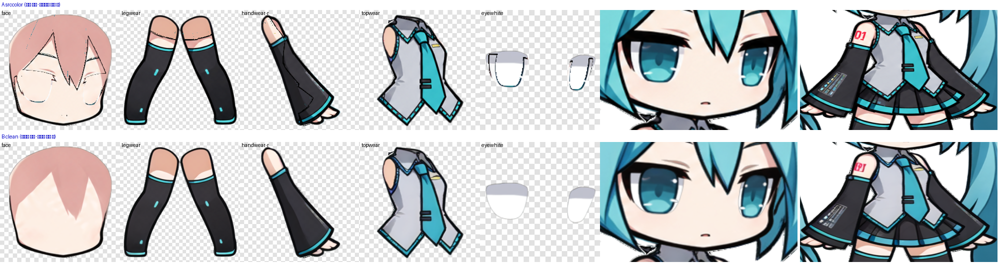
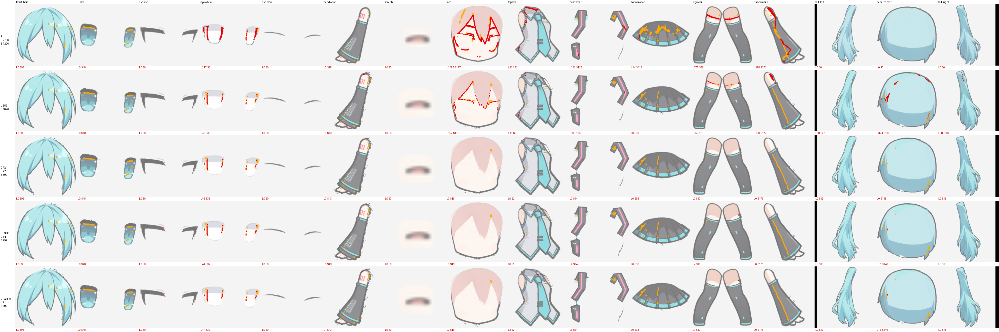
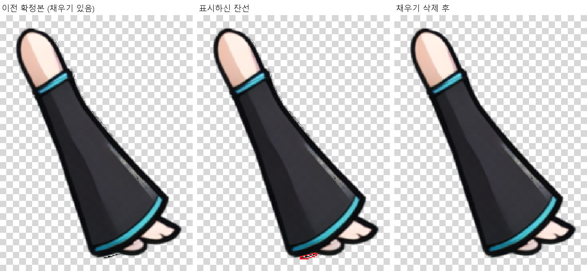
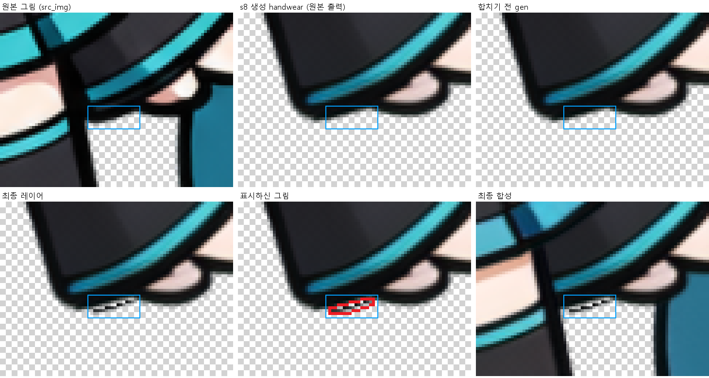
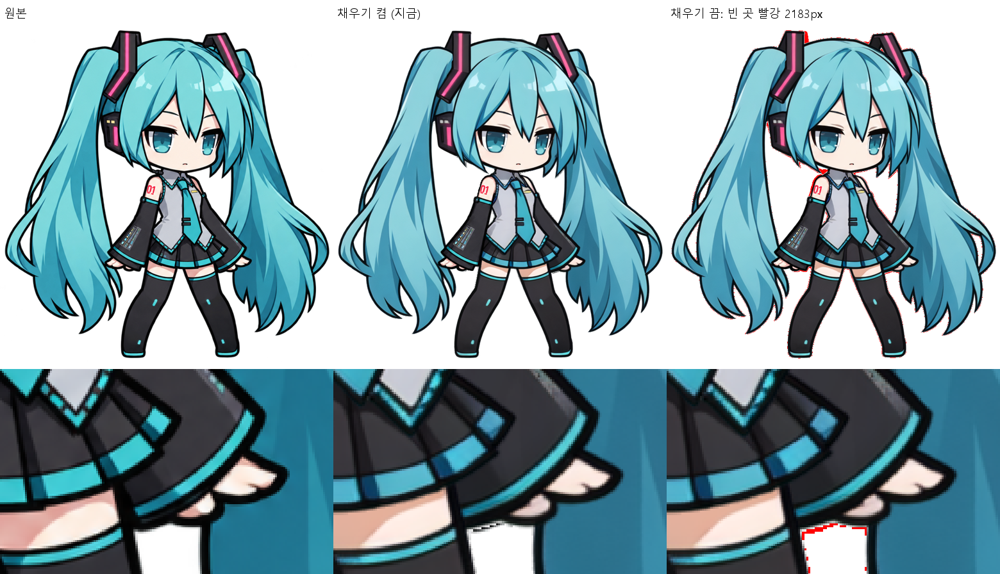

# 문제와 해결

실제로 막혔던 순서대로 단계별로 모았어요. 형식: **증상 → 원인 → 해결**. 시간순 원본 기록은 [HISTORY.md](HISTORY.md).

---

## 0. 공통 규칙 (어느 도구에서든)

| 증상 | 원인 | 해결 |
|---|---|---|
| 리그 조각을 돌리면 가장자리에 흰 선·검은 테 | 투명 픽셀의 RGB가 검정 → 엔진이 보간할 때 섞임 | 리그 조각은 `layer_common.bleed()`로 저장 (투명 픽셀에 가장자리 색). `split_joint.py`·`split_chain.py`는 자동 |
| 입(코) 둘레에 수염 같은 회색 테두리 | See-through의 입·코 레이어는 가장자리가 반투명 회색. **어떤 도구로 가져오든** 다른 그림 위에 올리면 보임 | 모양은 레이어, 색은 그 실행의 원본 그림(`src_img.png`): `tools/layer_common.py`의 `rgb_from_src`. `mix_layers.py`는 `"rgb_from": "src"`, `face_parts.py`는 자동. 새 도구도 이 함수를 쓰기 (한 번은 새 도구에서 빠뜨려 다시 생겼음) |

## 1. 설치

| 증상 | 원인 | 해결 |
|---|---|---|
| `conda create`에서 `SSL module is not available` | conda를 PATH에 넣지 않고 실행 | 그 창에서만 anaconda `Library\bin` 등을 PATH에 추가 ([INSTALL 2단계](INSTALL.md#2-파이썬-환경-python-312)) |
| 모델 받는 중 `WinError 1314` (심볼릭 링크 권한) | Hugging Face가 여러 파일을 동시에 받으면서 심볼릭 링크 지원 여부를 동시에 검사하다 꼬임 | 다운로드 전에 `huggingface_hub.file_download.are_symlinks_supported()`를 한 번 먼저 부르고 받기 |
| SAM2 설치가 CUDA 확장을 빌드하려다 실패하거나 torch를 바꿔 버림 | SAM2 기본 설치가 빌드·의존성 설치를 함 | `SAM2_BUILD_CUDA=0` + `--no-deps --no-build-isolation`, 커밋 c2ec8e1 |
| See-through가 `assets`를 못 찾음 | 저장소가 리눅스 심볼릭 링크(`assets → common/assets`)를 씀 | Windows에서는 `mklink /J assets common\assets` |
| `run_seethrough.ps1`이 python을 못 찾음 | conda 환경은 `env\python.exe`, venv는 `env\Scripts\python.exe` | 지금은 두 곳을 다 찾아요. 그래도 안 되면 `env` 위치와 `I2L_ROOT` 확인 |
| `--tblr_split`·`--seed`를 줬는데 효과가 없음 (summary.txt의 `ARGS`에 첫 값만 있음) | `powershell -File script.ps1 -Extra @(...)`로 부르면 배열의 첫 값만 전달됨 | PowerShell 창에서 `Set-ExecutionPolicy -Scope Process Bypass` 후 `& tools\run_seethrough.ps1 ...` |
| 내가 만든 `.ps1`이 `The string is missing the terminator`로 실패 | Windows PowerShell 5.1은 BOM 없는 `.ps1`을 ANSI로 읽어서 한글 문자열이 깨짐 | `.ps1` 안의 글은 영어로 쓰거나 UTF-8 BOM으로 저장 (저장소의 `.ps1`은 해당 없음) |
| 입력·출력 파일을 못 찾음 | 스크립트가 실행 중 `see-through` 폴더로 이동해서 상대 경로가 그 기준이 됨 | `-Src`, `-OutDir`는 절대 경로 |

## 2. See-through 실행 (메모리, 8GB GPU)
PC A(RTX 3070 8GB, RAM 16GB)에서 예제 한 장을 돌리기까지의 시도예요.

| 시도 | 결과 | 원인 / 판단 |
|---|---|---|
| 기본값 (group offload 켜짐) | 128초 만에 `CUBLAS_STATUS_NOT_INITIALIZED` | 텍스트 인코더만 따로 올리면 정상 → group offload와 bitsandbytes 4bit의 충돌로 추정 |
| `--no_group_offload` | VRAM 7.9GB가 차고 공유 메모리로 0.75GB 넘침. GPU 100%인데 29분 동안 첫 단계에서 멈춤 | 다른 프로그램이 이미 GPU를 2.5GB 쓰고 있었음 |
| `--cpu_offload` | 파이프라인을 만드는 중 RAM 부족으로 실행 도구가 강제 종료 | RAM 15.8GB로 부족 |
| `--cpu_offload` + 다른 프로그램 정리 | `Expected all tensors to be on the same device` | 코드가 입력 장치를 text_encoder 위치로 정함 → `run_patched.py`로 토큰 id를 CUDA로 |
| `--cpu_offload` + `run_patched.py` | VAE encode에서 또 장치 불일치 | 코드 여러 곳이 `self.unet.device` 등으로 장치를 정함 → cpu_offload 포기 |
| **`--no_group_offload` + GPU 쓰는 프로그램 종료** | **성공** | 기본 VRAM 사용 2.5GB → 0.8GB로 줄임 (게임 런처, 메신저, 데스크톱 캐릭터 앱 등) |

정리: 8GB GPU에서는 **`--no_group_offload`를 쓰고, 실행 전 GPU를 쓰는 프로그램을 모두 닫으세요.** 16GB GPU(PC B)에서는 신경 쓰지 않아도 돼요 (사용량 약 8GB).

## 3. 생성 결과

| 증상 | 원인 | 해결 |
|---|---|---|
| 같은 seed인데 PC마다 결과가 다름 (PC A의 헤드셋이 PC B에서 사라짐) | GPU마다 연산 결과가 조금씩 달라 생성이 갈라짐 | seed 하나에 기대지 말고 10개쯤 만들어 레이어별로 고르기 |
| 머리 부위(헤드셋)가 머리 상자 밖으로 잘림 | 머리 단계 상자가 머리 + 1/5 여백으로 고정 | `-HeadGrow N` ([WORKFLOW](WORKFLOW.md#머리-자르기-상자-넓히기--headgrow)) |
| 상자를 넓혔더니 헤드셋이 아예 사라짐 (seed3: 9,991px → 0, seed8은 얼굴 35,280px → 0) | 넓히면 머리 부위 전체를 다시 그림 | `head_grow.py`가 태그마다 마지막 회차에서 절반 아래로 줄면 가장 컸던 회차를 씀 (`HEAD_GROW_KEEP=max`, 기본). 앞 회차라 상자 경계에서 잘려 있을 수 있어요 |
| 넓힌 회차에서 헤드셋이 사라졌는데 넓히기가 그대로 끝남 | 멈추는 조건이 "테두리에 닿는 부위 없음"뿐이라, 사라지면 다 들어온 걸로 봄. 상자가 1~2px만 달라도 결과가 바뀜 | `-HeadBox`로 상자를 직접 정하고 `-HeadNeed headwear:8000,face:20000`으로 나올 때까지 머리 단계만 다시 그리기 |
| `-HeadBox` 다시 그리기에서 고른 시도에 얼굴이 비어 있음 | 통과한 시도가 없으면 `-HeadNeed` 부위 점수만 봄 | 필요한 부위(face 등)를 모두 `-HeadNeed`에 넣기, `-HeadTries` 늘리기 |
| 헤드셋이 엉뚱한 태그로 감 (seed1 → footwear, seed6 → objects에도) | 태그 분류가 흔들림 | 다른 태그도 확인. seed6 `objects`는 오히려 고리가 닫힌 더 좋은 모양이었음 |
| 트윈테일과 뒤통수가 back hair 하나로 나옴 | See-through에 트윈테일 칸이 없음 | `text_layers.py`로 나누고, 가려진 뒤통수는 `amodal_complete.py` |
| 몸이 없는 그림에서 handwear 같은 엉뚱한 레이어 | 태그가 고정이라 없는 부위도 무언가를 그림 | 그 레이어를 쓰지 않기 |

## 4. 다시 그리기 (SDXL)

| 증상 | 원인 | 해결 |
|---|---|---|
| 얼굴 회색 부분을 다시 그렸더니 머리카락·눈썹·눈이 생김 | 얼굴 모양 마스크를 주면 SDXL이 "얼굴"을 그림 | `--prefill median --strength 0.4` (피부색으로 먼저 칠하고 약하게 다듬기) |
| `key` 모드에서 분홍·노란 머리카락, 보라 테두리 | 마젠타 배경색이 번짐 | `--candidates`로 여러 개 그려 색이 맞는 것 고르기, 남은 테두리는 mix의 `despill: magenta` |
| `hull` 모드가 한쪽을 직선으로 자름 | 볼록 껍질 모양의 한계. `--debug`로 보면 마스크2가 그려도 되는 영역의 5%(2,814 / 51,933px)뿐 | `key` 모드 또는 `--shape`로 마스크2를 직접 그려 주기 |
| `amodal_complete.py` 결과가 이상한데 원인을 모름 | 중간 마스크가 남지 않음 | `--debug`로 ① 보이는 부분 ② 그려도 되는 영역 ③ 마스크2 ④ 먼저 칠한 상태를 저장해 차례로 보기 |
| `key` 후보 중 얼굴 옆모습이 그려짐 | 프롬프트·주변 문맥이 얼굴을 떠올리게 함 | 후보 중에서 고르기 (negative에 face 포함) |

## 5. 합치기 (`mix_layers.py`)

| 증상 | 원인 | 해결 |
|---|---|---|
| 입이 얼굴 뒤로 감 | 입 깊이 중앙값(0.50)이 얼굴보다 큼 | `"depth": 0.43` |
| 입에 수염 같은 회색 테두리 | 생성 레이어의 반투명 가장자리 색 | `"rgb_from": "src"` (See-through도 코·입은 원본 색을 씀). [공통 규칙](#0-공통-규칙-어느-도구에서든) |
| 레이어에 남의 검은 선 | 아래 [레이어에 남의 검은 선](#레이어에-남의-검은-선) | 레이어별로 생성 색(B) 선택 |
| 레이어에 점선 같은 잔선, 손으로 자른 조각에 원본 모서리가 덧붙음 | 아래 [레이어에 점선 같은 잔선](#레이어에-점선-같은-잔선) | `fill_missing` 삭제 |
| 두 다리를 좌우로 나눴더니 한쪽이 0px | 허벅지에서 8px 붙어 있어 연결 조각이 하나 | `"split_cut": true` |
| 직접 다듬은 레이어(`png`)로 바꿨더니 텅 빔 | 원래 설정의 `"split": "left"`가 한 조각짜리 수정본에 적용됨 | `png`로 바꿀 때 `split` 지우기 |
| 순서를 바꿨더니 고리 윤곽선이 얇아짐 | 뒤로 보낸 고리 위를 back_center가 덮음 | 의도한 순서인지 [확인 이미지](images/order_zoom.png)로 보고 결정 |

### 레이어에 남의 검은 선
**증상:** 합성은 원본과 비슷한데, 레이어를 하나씩 보면 face·legwear·handwear·eyewhite에 다른 부위의 윤곽선이 찍혀 있음.

**원인:** "보이는 픽셀은 원본 색으로"(A 방식, `visible_rgb: src`)는 **레이어 모양을 기준으로** 원본 색을 복사해요. 그런데
1. 여러 seed에서 고른 레이어는 원본과 모양이 1~5px씩 어긋나요. 경계에서 옆 부위의 윤곽선이 이 레이어로 복사돼요.
2. 앞 레이어의 반투명 가장자리 밑으로 복사가 이어지면서 더 번져요.
3. 더 근본적으로는 **seed마다 숨은 내용까지 다르게 그려요.** 예를 들어 s1의 face는 s1 앞머리 모양을 기준으로 이마를 분홍으로 그렸는데, 앞머리는 s9에서 가져왔어요.

원본에서 잘라낸 레이어(hair_input, PSNR 41.6dB)에서는 이 문제가 없었어요. 생성 레이어를 섞을 때만 생겨요.

**시도한 것** (선 = 다른 부위 경계 근처에서 생성본보다 어두워진 픽셀, A를 100%로)

| 시도 | 결과 |
|---|---|
| A에 색 차이 가드 (차이 60 넘으면 복사 안 함) | 레이어는 깨끗해졌지만 합성에 계단 현상 → 폐기 |
| owner: 원본 픽셀마다 색이 맞는 맨 앞 레이어 하나만 원본 색 | 선 33%, 합성 PSNR 41 |
| + 흐름 워프 (DIS optical flow로 레이어를 원본 쪽으로) | 평균 0.5px만 움직여 효과 없음 |
| + SAM2로 레이어 마스크 다시 따기 | 눈 레이어(IoU 0.1)를 비워 버림 → 탈락 |
| + Poisson 경계 블렌딩 | 숨은 부분에 회색 번짐 → 오히려 74~77% |
| + 선 넘겨주기 · 경계 보호 · 보호한 픽셀을 앞 레이어로 | **선 2%**, PSNR 40.3. 하지만 "01" 글자·속눈썹 끝 일부 손상, 앞 레이어 바깥 윤곽이 지저분 |

**결론:** 규칙으로 고치는 건 한계가 있었어요. **레이어마다 버전(A, B, …)을 나란히 놓고 사람이 고르는 것**이 가장 깔끔했고, miku는 전부 B(생성 색), handwear-l만 A로 확정했어요.

**측정할 때 주의:** 원본 자체의 선(머리카락 결 등)까지 세지 않도록 "다른 부위 경계 근처 + 그 픽셀 자체가 어두워짐"으로 세세요 (`layer_marks.py`). 고치는 규칙과 측정이 같은 것을 보면 숫자가 좋게만 나오니, 반드시 이미지로 확인하세요.

### 레이어에 점선 같은 잔선
**증상:** 색 방식을 B(생성 색)로 정한 뒤에도, 레이어 가장자리 바깥에 끊긴 점선 같은 검은 조각이 남음 (예: handwear-r 소매 끝 아래). 원본에도, See-through가 생성한 레이어에도 없던 선.

**원인:** `mix_layers.py`의 빈 곳 채우기(`fill_missing`).
1. 생성 레이어의 윤곽선이 원본보다 1~2px 어긋나 있어서, 그 틈에 원본의 윤곽선 일부가 어떤 레이어에도 덮이지 않고 남아요.
2. `fill_missing`이 그 픽셀을 **모양을 보지 않고** 가장 가까운 레이어에 원본 픽셀 그대로 붙였어요.
3. 생성 윤곽선이 덮은 곳은 빠지고 틈만 붙어서 끊긴 점선이 돼요. miku에서는 레이어 10장에 1,584px이 붙었어요 (handwear-r 132px은 덧붙은 픽셀이 모두 원본과 똑같았음).

단계별로 같은 곳(파란 상자)을 보면, 생성 레이어와 합치기 전 gen에는 없고 최종 레이어에서 처음 생겨요. 빨간 표시는 사용자가 잔선이라고 표시한 곳이에요.

이런 가는 조각은 지도(GIS)에서 **슬리버(sliver)**, 인쇄에서는 **정합 오차(misregistration)**가 만드는 틈과 같은 구조예요. 이것만 지우는 전용 모델은 찾지 못했어요.

**해결:** `fill_missing`을 **삭제**했어요. 덮이지 않은 원본 픽셀은 비워 둬요.

| | 채우기 있음 | 삭제 후 |
|---|---|---|
| 레이어에 덧붙은 원본 조각 | 1,584px | 0px |
| 합성의 빈 곳 | 749px | 2,183px (87%가 바깥 테두리 2px 안, 대부분 1~3px 점) |
| 합성 PSNR | 27.7dB | 27.6dB |

*합성에서는 바깥 윤곽선이 군데군데 1~2px 얇아지는 정도예요. 리깅용으로는 레이어가 깨끗한 쪽이 낫다고 판단했어요.*

같은 아이디어가 `assemble_layers.py`에도 있지만 그대로 뒀어요. 그 도구는 SAM2 등으로 **원본에서 잘라 낸** 레이어를 조립해서, 메우는 픽셀이 잘린 틈을 자연스럽게 잇기 때문이에요 (hair_input: 763px을 메워 PSNR 41.6dB).

## 6. 도구·환경

| 증상 | 원인 | 해결 |
|---|---|---|
| `review_seethrough.py`가 결과 폴더 이름과 그림 이름이 다르면 실패 | 이름을 폴더에서 읽음 | PSD 파일 이름에서 읽게 수정 |
| PSD 저장 중 `UnicodeEncodeError` / `encoding with 'macroman' codec failed` | psd-tools가 그룹(폴더) 이름을 옛 형식으로도 저장하는데 한글을 못 씀 | 그룹 이름은 영문으로 (`variants (hidden)`) |
| `selftest_psd_report.py`가 `Group.new() got multiple values for argument 'parent'` | psd-tools 1.14에서 `Group.new(parent, name)` 순서 | 인자 순서 수정 |
| psd-tools로 만든 PSD의 레이어 투명도가 사라짐 (`topil()`이 알파 255) | `PSDImage.new("RGB")`로 만듦 | `PSDImage.new("RGBA")` (`mix_layers.py`는 처음부터 RGBA) |
| 확인 이미지 저장 실패 `OSError: [Errno 22] Invalid argument` | 그 파일을 다른 프로그램(이미지 뷰어)에서 열고 있음 | 닫고 다시 실행 |
| 확인 이미지의 한글이 네모로 나옴 | PIL 기본 글꼴에 한글 없음 | `ImageFont.truetype('C:/Windows/Fonts/malgun.ttf', ...)` |
| 실행 중 작업이 강제 종료됨 (Claude Code에서 돌릴 때) | RAM이 부족하면 Claude Code가 백그라운드 작업을 끔 | 다른 프로그램을 줄이거나 `CLAUDE_CODE_DISABLE_BG_SHELL_PRESSURE_REAP=1`로 시작 |

## 7. 리깅용 나누기

| 증상 | 원인 | 해결 |
|---|---|---|
| 관절에서 자른 다리를 굽히면 무릎에 틈 | 조각 끝이 직선 | 앞 조각에 둥근 관절 캡 (`split_joint.py`) |
| 관절 캡에 원본 픽셀을 그대로 쓰니 무늬(하늘색 점)가 두 번 보임 | 캡이 다른 조각의 무늬까지 복사 | 자르는 선을 무늬 밖으로 옮기거나, 앞 조각 쪽에 캡을 두고 무늬가 함께 움직이게 |
| 캡 가장자리에 계단 | 캡에 외곽선이 없음 | 외곽선 4px |
| 캡 외곽선이 서 있을 때도 무릎에 선으로 보임 | 외곽선이 캡과 같은 레이어 | **외곽선만 따로 떼어(`*_joint_line.png`) 앞 조각 뼈에 붙이고, 그리는 순서는 뒤 조각보다 뒤** → 배경과 닿는 곳에만 보임 |
| 굽힐 때 관절 안쪽에 흰 홈 | 뒤 조각이 자르는 선에서 끝남 | 뒤 조각도 앞쪽으로 캡 반지름만큼 더 (서 있으면 앞 조각에 가려짐) |
| 새로 뽑은 일러를 부품으로 쓰려니 머리·팔·다리 위치가 다 다름 | 처음부터 새로 그린 그림 | 원본을 넣고 **"포즈·구도 그대로, 표정만"** 편집 요청 → 같은 설정으로 See-through → `face_parts.py` |
| 표정 smile의 홍조, surprised의 땀이 사라짐 | See-through가 face 레이어에 그림 | `face_parts.py`가 face 차이에서 따로 떼어 냄 (`blush`, `sweat`) |
| oh·sleeping처럼 홍조가 없는 표정에서도 홍조가 잡힘 | face 색 차이만 봄 | 눈 가운데보다 아래 + 얼굴 가장자리에서 10px 안쪽, 그 픽셀 자체가 분홍, 덩어리가 둥근 것만 |
| 입 둘레에 살색 호가 남거나, 작은 입(calm 등)이 깎임 | 입 테두리 정리가 너무 셈 | 어두운·빨간 픽셀 중심으로 구멍 메우고 가장 큰 조각만 남김, 200px 미만 입은 정리 안 함 |
| 소매 안 팔이 없어서 팔꿈치를 못 나눔 | 원본에 가려진 부분 | 두 팔을 맨 앞으로 올린 합성 → 편집 AI "토시만 지우기" → 맨팔 See-through → v1 화면에 맞춤 |
| 손으로 그은 선으로 자른 소매 끝이 계단지고 양쪽 두께가 다름 | 선이 픽셀 단위 + 손으로 그음 | `sleeve_cloth.py --edge auto`: 청록 띠에서 옆 외곽선 두께만큼 바깥, 1px 부드러운 끝 |
| 소매 끝 외곽선이 옆보다 얇음 | 두께를 숫자로 정함 | `--edge auto`: 옆 외곽선 두께를 재서 씀 |
| 조각을 돌리면 자른 선을 따라 흰 선 | 투명 픽셀 RGB가 검정 → bicubic이 넘쳐 흰색 | `layer_common.bleed()`로 저장 (투명 픽셀에 가장자리 색), 확인 시트는 bilinear |
| 손목을 비스듬히 자르니 단면이 넓고 하박 조각이 이상함 | 소매 모서리를 따라 비스듬한 선 | 맨팔에 팔과 수직인 선을 사람이 그음 |
| 손목 회전 기준점을 팔 쪽으로 옮기면 손목에 홈 | 자르는 선은 그대로 두고 기준점만 옮김 | 손목은 돌리지 않고 손을 갈아 끼우기로 (`--cap 0`) |
| 편집 AI가 "가리키기"를 양손에 엉성하게 그림 | 내린 손으로는 가리키는 모양이 어려움 | 리그 조각으로 그 팔만 어깨에서 든 그림 → 한 손만 편집 → 자른 뒤 되돌림 |
| See-through가 손에 쥔 마이크를 지우고 빈 주먹으로 그림 | 물건이 handwear 태그에 안 들어감 | 입력 그림에서 마이크·쥔 손을 마스크로 가져옴 |
| 편집 결과 배경이 검정 | 투명 배경이 RGB로 저장되며 검정이 된 것으로 보임 (open·relax 두 장만) | 테두리에 이어진 검정만 흰색으로. 처음엔 바깥 외곽선까지 지워져서, 맨팔 그림의 알파로 외곽선을 되살림 |
| 편집한 손을 끼우니 손목에서 외곽선이 2~4px 끊김 | 편집으로 팔 위치·손목 폭이 조금씩 바뀜 | 팔마다 이동만 다시 맞추고, 손목 단면을 하박 폭에 맞춰 늘림 (선에서 14px 가면 효과 0) |
| 트윈테일을 V자로 자르니 굽힐 때 이음매·외곽선 턱 | 앞 조각이 딱 잘림 | `split_chain.py --feather 8`: 앞 조각이 선 너머로 서서히 사라짐 |
