# 작업 흐름: 그림 한 장 → 레이어 PSD → 리깅용 조각

예시: `examples/miku/input/miku_chibi_sprite.png` (1312×1199, 전신 SD 캐릭터) → `examples/miku/final/miku_v1.psd` (21레이어) → `examples/miku/final_v2/` (리깅용 45레이어 + `rig.json`)

자동 파이프라인이 아니에요. **단계마다 확인 이미지를 보고 사람이 고르는** 흐름이고, 고르는 곳은 ✋로 표시했어요.
명령의 `$PY`는 `env\Scripts\python.exe`(venv) 또는 `env\python.exe`(conda), 경로는 모두 절대 경로로 쓰는 걸 권해요.

```
1. 여러 seed로 생성 ─▶ 2. seed 비교 ✋ ─▶ 3. 레이어마다 seed 골라 합치기 ✋
                                                │
   4. 가려진 부분 생성 (필요한 레이어만) ✋ ◀────┘
                │
   5. 레이어별 색 방식 ✋ ─▶ 6. 레이어 손질 (나누기·순서·지우기) ✋ ─▶ 7. 확정
                                                                      │
   9. 리깅용 확정본 ◀── 8. 리깅용 나누기 (관절·손·트윈테일·표정) ✋ ◀──┘
```

---

## 1. 여러 seed로 생성
```powershell
Set-ExecutionPolicy -Scope Process -ExecutionPolicy Bypass   # 지금 창에서만 .ps1 실행 허용
foreach ($s in 0..9) {
  & tools\run_seethrough.ps1 -Src C:\work\char.png -OutDir C:\work\out\seed$s `
    -Extra @('--no_group_offload','--tblr_split','--seed',"$s") -HeadGrow 3
}
```
- See-through가 몸 13태그(front hair, back hair, head, topwear …)와 머리 11태그(headwear, face, irides, eyelash …)를 1024 정사각형 페이지에 그려요. 태그마다 `<태그>.png`와 `<태그>_depth.png`, 그리고 PSD가 나와요.
- **seed가 하나면 안 돼요.** 같은 그림이라도 seed마다, 심지어 GPU마다 결과가 달라요. miku에서는 seed마다 헤드셋이 있거나 없고, 얼굴이 비거나, 뒤통수에 구멍이 났어요. 10개 정도 만들어 두고 레이어별로 고르는 게 가장 좋았어요.
- 특정 부위가 나올 때까지 seed를 돌리려면: `tools\seed_search.ps1 -Src ... -OutRoot C:\work\out\seed -Tag headwear -MinPx 8000 -HeadGrow 3`

### 머리 자르기 상자 넓히기 (`-HeadGrow`)
See-through는 두 단계로 그려요.
1. **몸 단계**: 전체 그림으로 몸 13태그. 이때 나온 `head` 레이어로 머리 위치를 정해요.
2. **머리 단계**: 머리 둘레를 잘라 확대해서 머리 11태그를 자세히 그려요. 상자는 **머리 크기 + 사방 1/5 여백으로 고정**이에요.

미쿠의 헤드셋 고리처럼 머리 위로 솟은 부위는 이 상자 밖으로 잘려요. `-HeadGrow N`을 주면 `tools/head_grow.py`가 이렇게 해요.
1. 머리 단계를 돌린 뒤, 머리 부위가 상자 테두리에 닿았는지 봐요 (가장자리 2px 안에 8px 이상).
2. 닿은 쪽만 머리 크기의 0.25배씩 넓혀요 (한쪽 최대 1배).
3. **같은 난수 상태로** 머리 단계를 다시 돌려요. 상자 크기만 바뀌어요.
4. 닿은 곳이 없거나 N번을 다 쓰면 멈춰요. 회차별 상자는 `head_grow.json`에 남아요.

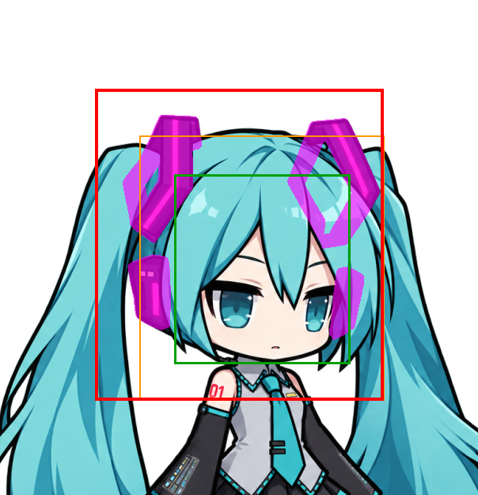
*seed0: 1회차(주황)에 왼쪽·위가 닿아 넓힘 → 2회차(빨강)에는 닿은 곳 없음. 회차 기록: [head_grow_seed0.json](images/head_grow_seed0.json)*

주의: 상자를 넓히면 머리 부위 전체가 다시 그려져서 **오히려 나빠질 때도 있어요** (seed3은 넓힌 뒤 헤드셋이 사라짐). 그래서 어떤 태그가 마지막 회차에서 절반 아래로 줄면 가장 컸던 회차의 것을 써요 (`HEAD_GROW_KEEP`, [TOOLS](TOOLS.md#head_growpy)). 회차별 결과는 `head_grow/pass<회차>/`에 있어요.

넓혀도 원하는 부위가 안 나오면, 상자를 직접 정하고 그 부위가 나올 때까지 머리 단계만 다시 그려요: `-HeadBox x0,y0,x1,y1 -HeadNeed headwear:8000,face:20000` (좌표는 `src_img.png` 기준, [TOOLS](TOOLS.md#사람이-정한-상자--headbox)).

## 2. seed 비교 ✋
```powershell
& $PY tools\compare_seeds.py --run s0=C:\work\out\seed0 --run s1=C:\work\out\seed1 ... --out C:\work\out\seed_compare.png
& $PY tools\review_seethrough.py --run C:\work\out\seed9 --src C:\work\char.png   # seed 하나의 단계별 검토 이미지 → seed9\review\
```
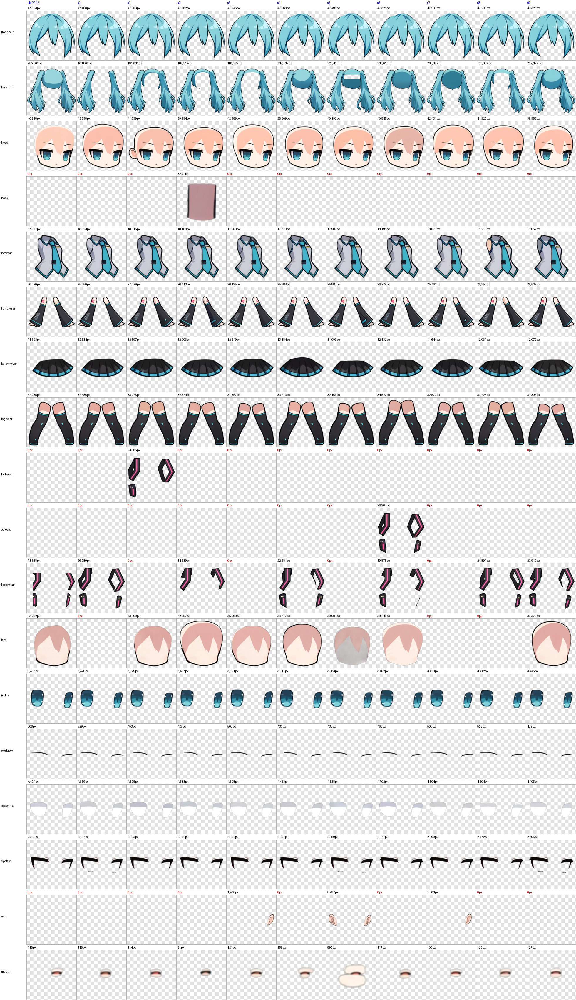
*행 = 태그, 열 = seed. 빈 레이어는 빨간 0px.*

seed 하나를 자세히 볼 때는 `review/` 이미지를 봐요 ([seed9 예시](images/review_seed9/)).
| 파일 | 보는 것 |
|---|---|
| `step21_body_tags.png`, `step23_head_tags.png` | 몸·머리 태그별 결과 |
| `step22_head_crop.png` | 머리 자르기 상자 (주황 = 이전 회차, 빨강 = 최종) |
| `step24_depth.png`, `step25_psd_stack.png` | 깊이 순서, PSD가 쌓이는 과정 |
| `step26_coverage.png` | 원본에 있는데 어떤 레이어도 덮지 않은 곳 (빨강) |
| `step27_hidden_parts.png` | 앞 레이어에 가려지는 부분 (초록) |

miku에서 고른 것: front hair s9 · 트윈테일 s0 · face~mouth s1 · topwear s8 · handwear s8 · bottomwear s4 · legwear s1 · headwear s6.

## 3. 레이어마다 seed 골라 합치기 ✋
모든 seed가 **같은 1024 페이지 좌표**를 써서, 레이어를 자유롭게 섞을 수 있어요. 고른 것을 spec(JSON)으로 적고 `tools/mix_layers.py`로 합쳐요.
```json
{
 "src": "C:/work/out/seed0/char/src_img.png",
 "layers": [
  {"name": "front hair", "run": "C:/work/out/seed9", "tag": "front hair", "keep_rgb": true},
  {"name": "tail_left",  "run": "C:/work/out/seed0", "tag": "back hair", "split": "left", "keep_rgb": true},
  {"name": "mouth",      "run": "C:/work/out/seed1", "tag": "mouth", "depth": 0.43, "rgb_from": "src"}
 ]
}
```
```powershell
& $PY tools\mix_layers.py --spec C:\work\spec.json --out C:\work\out\mix
```
결과: `layers/NN_이름.png`(앞→뒤), `mix.psd`, `composite.png`, `check.png`(빠짐·넘침·색 차이·PSNR), `sheet.png`, `hidden.png`(초록 = 가려지는 부분, 윤곽 안에 체커보드가 보이면 구멍).
옵션 전체는 [TOOLS.md](TOOLS.md#mix_layerspy).

원본에는 있는데 어떤 레이어도 덮지 않은 픽셀(`check.png`의 빨강)은 **그대로 비워 둬요.** 생성 레이어의 윤곽선이 원본보다 1~2px 어긋나서 생기는 가는 틈이고, 대부분 캐릭터 바깥 테두리예요 (miku: 2,183px, 87%가 바깥 테두리 2px 안). 예전에는 이 픽셀을 가장 가까운 레이어에 원본 픽셀로 붙였는데, 레이어에 점선 같은 잔선이 남아서 그 기능(`fill_missing`)을 없앴어요 ([자세히](TROUBLESHOOTING.md#레이어에-점선-같은-잔선)).

## 4. 가려진 부분 생성 (필요한 레이어만) ✋
See-through에는 트윈테일 칸이 없어서 트윈테일이 back hair에 합쳐져요. miku에서는 back hair를 트윈테일 좌/우와 뒤통수로 나누고, 트윈테일에 가려진 뒤통수를 새로 그렸어요.
1. **나누기** `tools/text_layers.py`: Grounding DINO(글 → 상자) + SAM2(상자 → 마스크) + LaMa(경계 틈 메우기)
   ```powershell
   & $PY tools\text_layers.py --image "back hair.png" --out C:\work\out\back --part "back_center=*" --part "tail_left=twin tail@left" --part "tail_right=twin tail@right"
   ```
   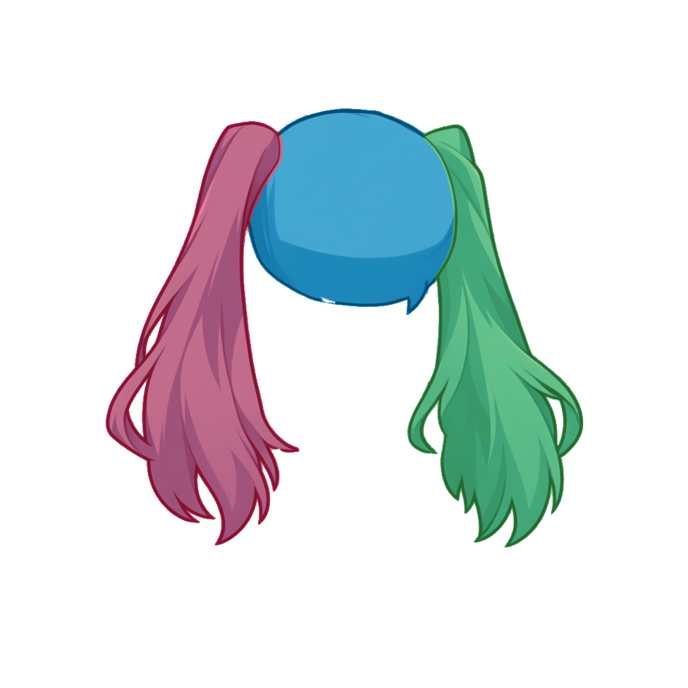
2. **가려진 곳 그리기** `tools/amodal_complete.py` (SDXL 인페인팅): 앞 레이어(트윈테일)를 지우고, 이어졌을 모양만 그려요.
   - `--mode hull`: 보이는 부분의 볼록 껍질만큼 칠하고 다듬어요. 색은 안전하지만 모양이 딱딱해요 (miku에서는 오른쪽이 직선으로 잘림).
   - `--mode key`: 마젠타 배경 위에 SDXL이 모양까지 그려요. 모양은 자연스럽지만 색이 흔들려서 `--candidates`로 여러 개 만들어 골라요.

   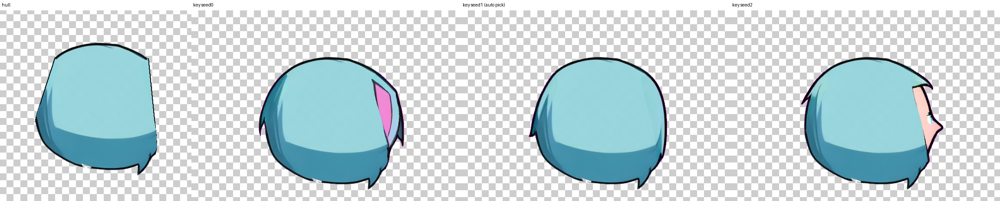
   *key 모드 후보 3개 → seed1 채택 (seed0 분홍 조각, seed2 얼굴 옆모습)*

   결과가 이상하면 `--debug`를 붙여 다시 돌려 보세요. 결과는 그대로이고, 보이는 부분 → 그려도 되는 영역 → 실제로 그린 모양(마스크2) → (hull) 먼저 칠한 상태가 차례로 저장돼요. 예시 출력: [`examples/miku/back_center/amodal_debug_test/`](../examples/miku/back_center/amodal_debug_test/)

   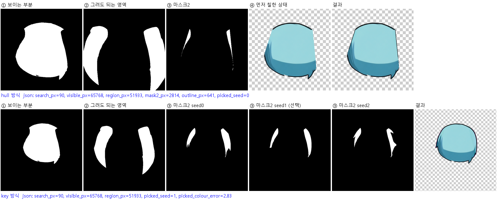
   *hull은 마스크2가 그려도 되는 영역의 5%뿐이라 오른쪽이 직선으로 남음*
3. spec에서 그 레이어를 `"png": "<완성 파일>"`로 바꾸고, 마젠타 잔여는 `"despill": "magenta"`.

## 5. 레이어별 색 방식 ✋
| 방식 | spec | 장점 | 단점 |
|---|---|---|---|
| **B (생성 색)** | `"keep_rgb": true` | 레이어가 깨끗해요 | 합성이 원본과 조금 달라요 (PSNR ~28dB, 세부 글자 등) |
| **A (원본 색)** | 전체 `"visible_rgb": "src"` | 합성이 원본에 가까워요 | seed가 섞인 레이어에 **남의 선이 찍혀요** |

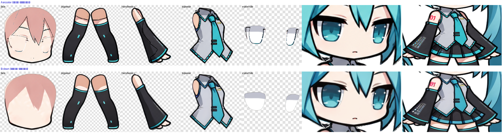

A의 선 문제를 자동으로 없애려고 여러 방법을 시도했지만([TROUBLESHOOTING.md](TROUBLESHOOTING.md#레이어에-남의-검은-선)), 결국 **레이어마다 버전을 나란히 놓고 고르는** 게 가장 깔끔했어요.

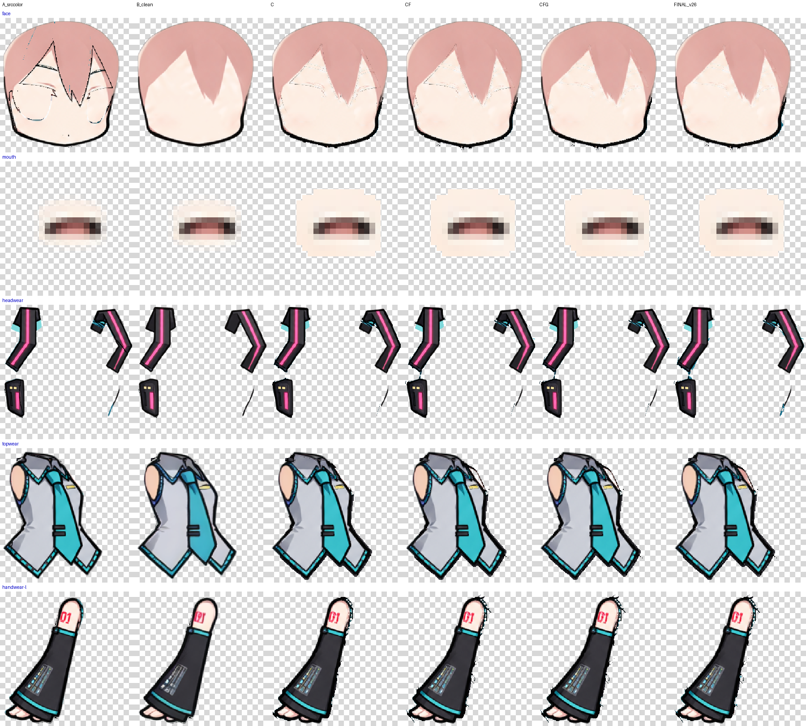
*`tools/compare_variants.py`로 만든 시트. 행 = 레이어, 열 = 버전. 전체: [pick_sheet/](images/pick_sheet/)*

miku에서는 **전부 B, handwear-l만 A** ("01" 글자를 원본 그대로 살리려고).

## 6. 레이어 손질 ✋
| 하고 싶은 것 | 방법 | miku 예 |
|---|---|---|
| 다른 seed나 태그의 더 좋은 모양 쓰기 | `"tag"`를 바꾸거나 `"png"` | headwear 대신 s6 `objects`(고리가 닫힌 모양) |
| 한 레이어를 사람이 그린 경계로 나누기 | 경계를 빨간 선으로 그린 그림 → 마스크 → 조각 PNG → `"png"` | 헤드셋 고리를 앞/뒤로 ([headwear/](../examples/miku/headwear/)) |
| 붙어 있는 두 조각 나누기 | `"split": "left"` + `"split_cut": true` | 허벅지에서 붙은 두 다리 |
| 레이어 순서 정하기 | `"depth"`로 고정 (작을수록 앞) | 사람이 정한 21개 순서 ([확인](images/order_check.png)) |
| 직접 다듬은 레이어 쓰기 | `"png"` + `"keep_rgb"` (원래 있던 `"split"`은 지우기) | handwear-l ([확인](images/manual_handwear_check.png)) |
| 움직일 때 드러날 부분 그려 넣기 | 레이어에 직접 그린 파일 → `"png"` + `"keep_rgb"` | topwear에 목 추가: 정지 합성은 그대로, 고개를 들면 틈을 메움 ([합성](images/topwear_neck_result.png), [머리 움직임](images/neck_tilt_zoom.png), [머리 ±12° 기울임](images/neck_tilt_preview.png)) |
| 특정 부분 지우기 | 합성 그림에 지울 곳을 빨간 선으로 → 마스크 → `"erase"` | 고리 위·목 옆 잔여물 ([확인](images/erase_check.png)) |
| 레이어 빼기 | spec에서 지우거나 `"hidden": true` | neck, 오른쪽 스피커 |

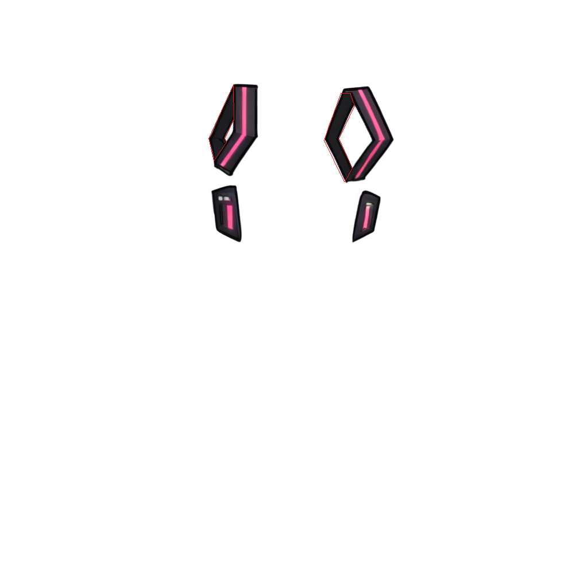
*사람이 빨간 선으로 "뒤로 갈 부분"을 표시 → 고리 앞은 front hair 뒤·트윈테일 앞, 고리 뒤는 모든 머리 뒤*

## 7. 확정
최종 spec과 결과를 한 폴더에 모아요 → [examples/miku/final/](../examples/miku/final/) (`miku_v1.psd`, `layers/`, `composite.png`, `sheet.png`, `hidden.png`, `spec.json`).

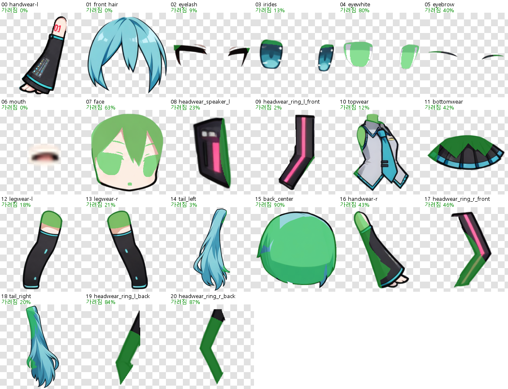
*최종 21레이어. 초록 = 앞 레이어에 가려지는 부분 (움직이면 드러남)*

---

## 8. 리깅용 나누기 ✋
확정본 레이어를 움직일 수 있게 더 나눠요. miku는 **항상 측면(지금 그림 = 왼쪽을 봄, 반대는 좌우 반전)** 만 보여 줘서, 뒤돌기·정면용 그림은 만들지 않아요. 기준은 "AI 모델이 만들 수 있는 에셋인가"예요. 이름의 l/r, left/right는 **보는 사람 기준**(그림 왼쪽/오른쪽)이에요.

1. **다리 (관절)** `split_joint.py`: 사람이 무릎에 빨간 선 → 그 선으로 자름. 아래 조각(종아리)이 앞, 관절 외곽선은 따로 떼어 맨 뒤. ([도구 설명](TOOLS.md#split_jointpy))
2. **팔**: 소매(토시) 안의 팔이 원본에 없어서 그림부터 새로 얻어요.
   1. v1 합성에서 두 팔을 맨 앞으로 올린 그림 → 이미지 편집 AI에 **"토시만 지우고 나머지 그대로"** → 맨팔 그림
   2. 맨팔 그림을 See-through (seed 10개 모두 팔이 handwear 한 장으로 나옴) → 실루엣으로 v1 화면에 맞춤(배율·이동)
   3. 사람이 맨팔에 팔꿈치·손목 선(팔에 수직으로) → `split_joint.py`: 팔꿈치는 하박이 앞 + 관절 외곽선, 손목은 `--cap 0`(손은 돌리지 않고 갈아 끼움)
   4. 소매는 `sleeve_cloth.py --edge auto`로 천만 남긴 뒤, `split_joint.py --pivot <맨팔 팔꿈치>`로 위·아래 (소매와 맨팔이 같은 팔꿈치로 굽음)
   5. 그리는 순서 (앞→뒤): 소매 아래, 소매 위, 소매 관절선, 손, 하박, 상박, 하박 관절선
3. **손 모양**: 맨팔 그림을 편집 AI에 **"팔·자세 그대로, 손 모양만"** (주먹·편 손·마이크·브이·힘 뺀 손) → See-through → v1 화면에 맞춤 → 같은 손목 선으로 자름 → `hand_<모양>_l/r`
   - 편집하면 팔 위치가 1~4px씩 틀어져요. 배율은 그대로 두고 팔마다 이동만 다시 맞추고(손목 선 근처로 다듬기), 손목 단면 폭이 하박과 다르면 손목 쪽만 늘여 맞춰요.
   - 가리키기처럼 손만 바꾸기 어려운 모양은, 리그 조각으로 그 팔을 어깨에서 든 그림을 만들어 편집 → 자른 뒤 되돌려요.
   - See-through가 손에 쥔 물건(마이크)을 지우면 입력 그림에서 그 부분을 가져와요.
4. **트윈테일** `split_chain.py`: 사람이 V자 선 2줄 → 뿌리/중간/끝, 위 조각이 앞, 이음매는 `--feather`로 서서히. 안 자른 버전도 같이 둬요. ([도구 설명](TOOLS.md#split_chainpy))
5. **표정**: 원본을 이미지 편집 AI에 넣고 "포즈·구도·크기 그대로, 표정만 바꿔 줘"로 한 장씩 (miku: calm·smile·ah·ee·oh·surprised·sleeping)
   → 원본 눈·입과 같은 설정(seed·`-HeadGrow`)으로 See-through
   → `face_parts.py`로 눈 좌·우, 입, 홍조, 땀 ([도구 설명](TOOLS.md#face_partspy))
   - 처음부터 새로 그린 일러는 머리·팔·다리 위치가 달라서 부품으로 못 써요.
6. 다른 캐릭터에도 쓸 효과(땀방울 등)는 `effects/`에 잘라서 따로 둬요.
7. 치마·앞머리·몸통은 조각으로 나누지 않았어요 (메시 변형을 검토 중).

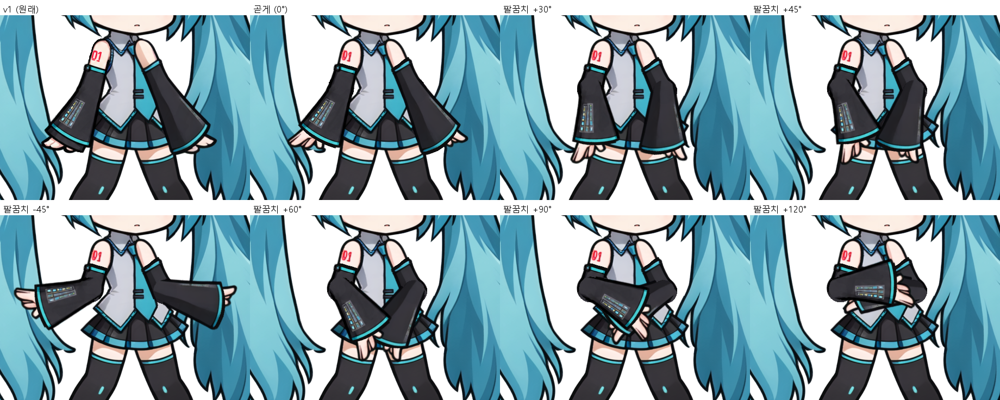
*팔꿈치 −45°~+120°: 소매와 맨팔이 같은 팔꿈치로 굽고 손은 하박에 붙어 따라감*

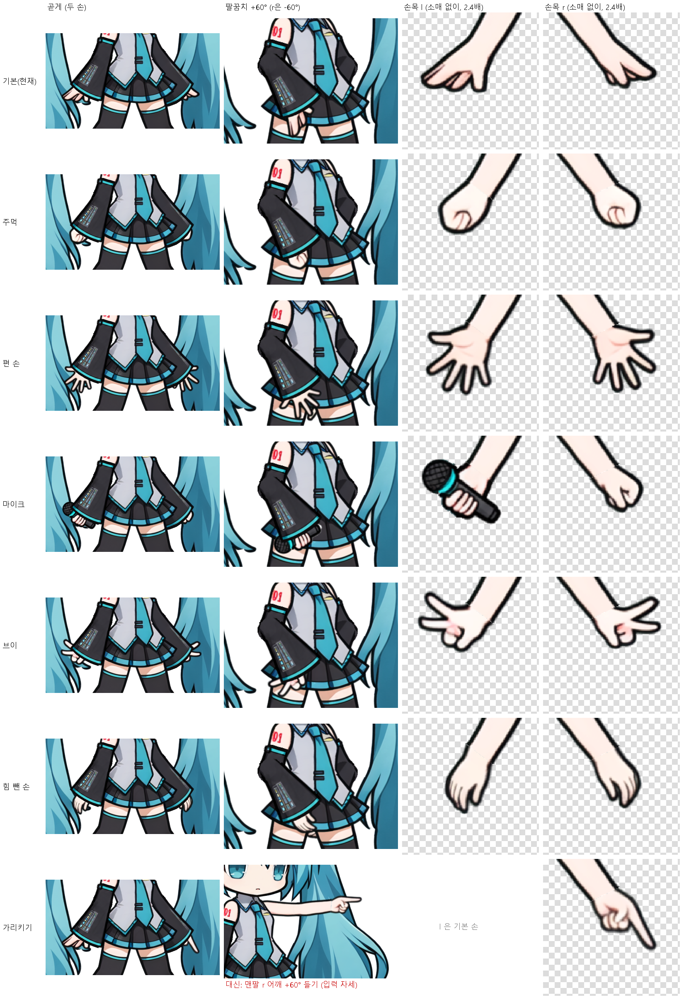
*손 모양 7종(기본·주먹·편 손·마이크·브이·힘 뺀 손·가리키기): 곧게, 팔꿈치 굽힘, 소매 없이 손목 확대*

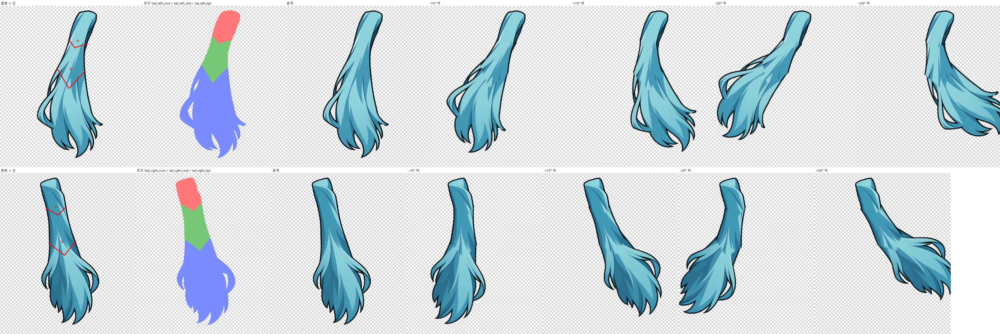
*트윈테일 3조각: 곧게, 관절마다 ±10°, ±20°*

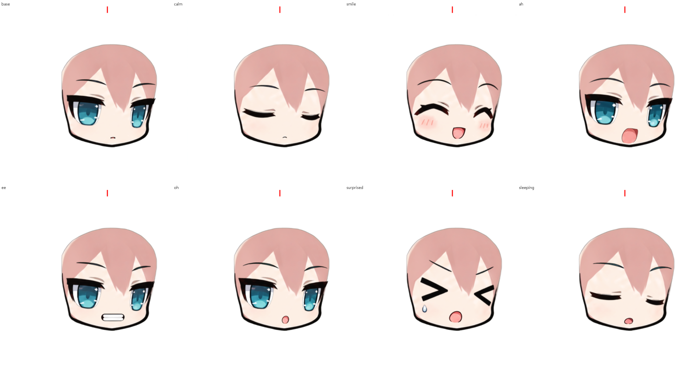
*v1 얼굴에 표정 7장의 눈·입만 바꿔 끼움 (smile 홍조, surprised 땀 포함)*

## 9. 리깅용 확정본
나눈 조각을 한 벌로 묶어요 → [examples/miku/final_v2/](../examples/miku/final_v2/) (`README.md`에 자세히).
- `layers/` 45장 (앞→뒤 번호), 쌓으면 v1과 같은 그림 (다른 곳은 다시 만든 맨팔·손뿐)
- `rig.json`: 그리는 순서, 레이어별 뼈, 뼈 16개(부모·기준점), 슬롯(손 l 6종·r 7종, 표정 7종, 안 자른 트윈테일)
- `variants/`, `miku_v2.psd`(기본 레이어 + 숨긴 variants 그룹), `sheet.png`
- 만든 스크립트: `examples/miku/rig/build_v2.py`, `v2_sheet.py`. 작업 폴더의 중간 결과(`seethrough_test/...`)를 읽어서 저장소에서는 그대로 돌아가지 않아요 (형식 참고용).

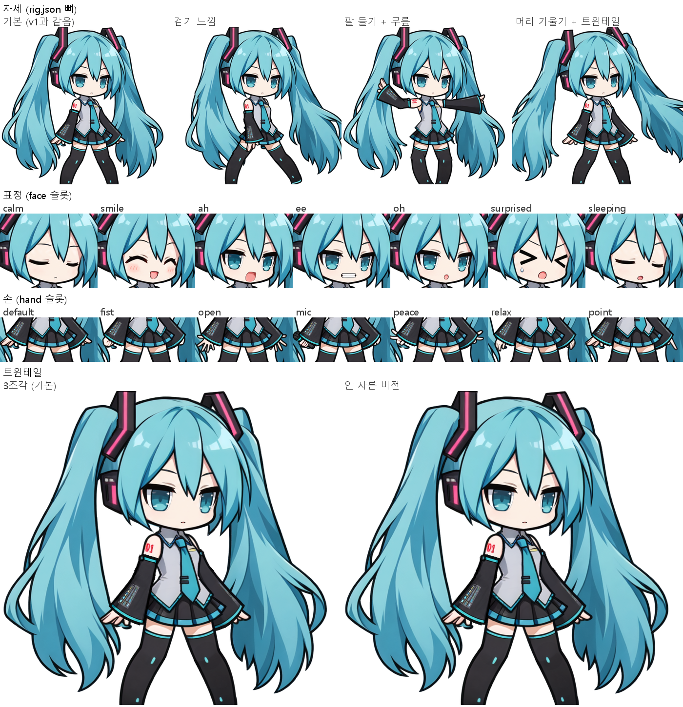

---

## 단순한 경우: 레이어 몇 장만 필요할 때
머리카락 몇 장처럼 레이어가 적고 seed를 섞지 않을 때는 이 순서가 더 간단해요. 레이어를 원본에서 잘라내는 방식이라 합성이 원본과 거의 같아요 (hair_input 5장, PSNR 41.6dB).
1. `run_seethrough.ps1` 한 번 → 쓸 레이어만 고르기
2. `text_layers.py`로 더 나누기
3. 이상한 부분은 `mask_inpaint.py`로 다시 그리기 (얼굴처럼 엉뚱한 걸 그리기 쉬운 곳은 `--prefill median --strength 0.4`)
4. 가려진 부분은 `amodal_complete.py`
5. `assemble_layers.py`: 원래 크기로 되돌리고, 보이는 부분은 원본 픽셀로 PSD 만들기

## 사람이 판단한 곳 (자동화하기 어려운 부분)
1. 레이어마다 seed 고르기
2. amodal 후보 고르기
3. 레이어마다 색 방식 A/B 고르기
4. 한 레이어를 나눌 경계 그리기 (헤드셋 고리)
5. 레이어 순서
6. 레이어 직접 다듬기, 지울 곳 표시
7. 리깅: 관절·손목·트윈테일을 자를 선, 조각 앞뒤 순서, 표정·손 모양 편집 요청과 결과 고르기, 각도가 자연스러운지 판단
